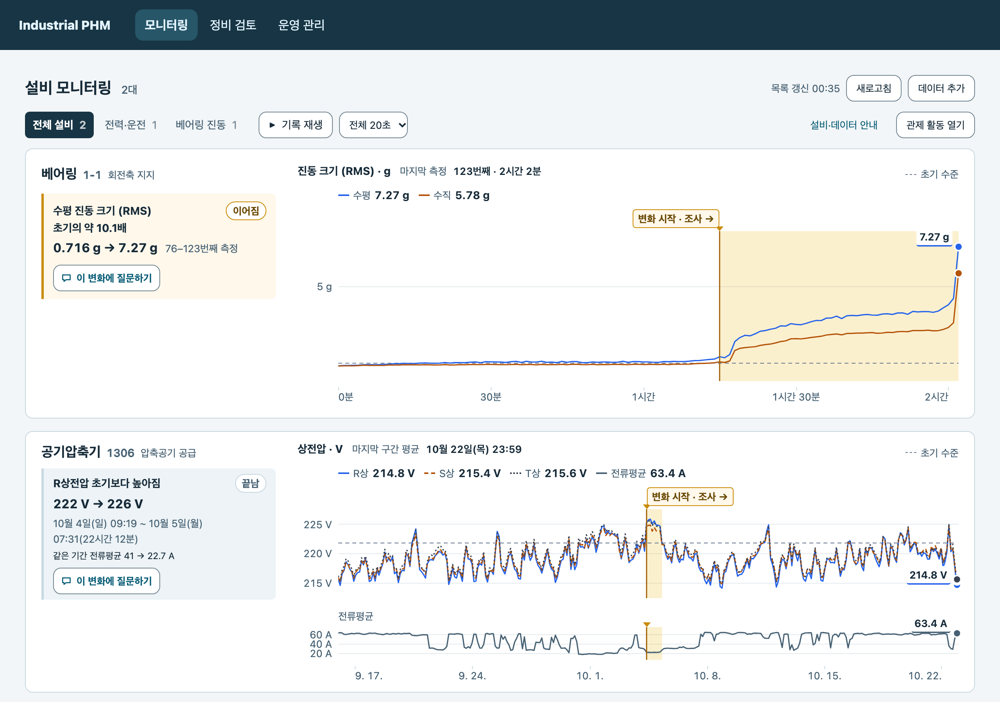
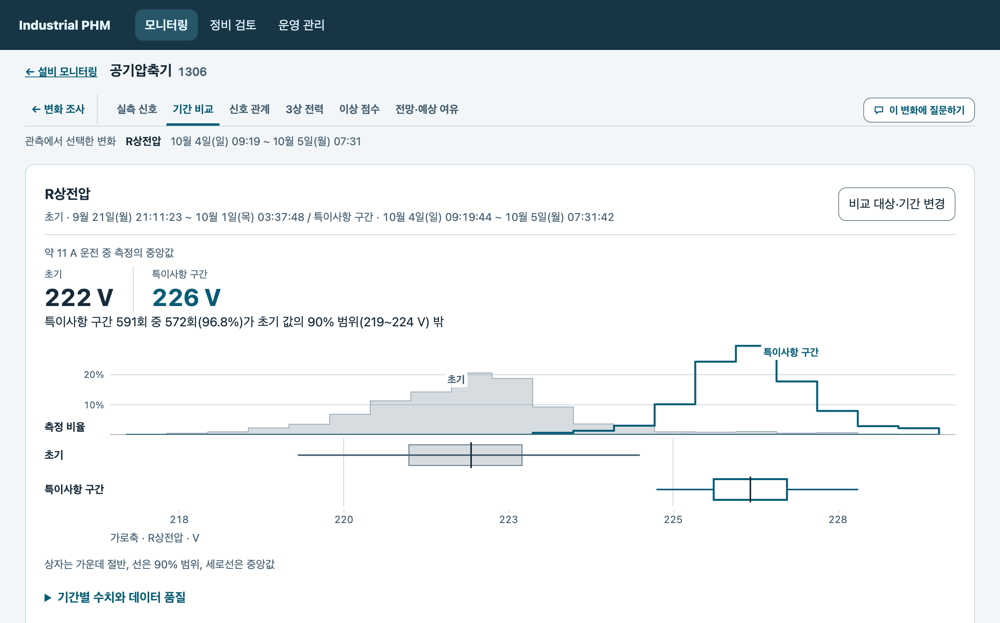

# Industrial PHM Framework

**실제 설비의 전력·진동 기록에서 달라진 구간을 찾고, 운전 조건과 주파수를 비교해 점검할 대상을 좁히는 오픈소스 PHM 애플리케이션입니다.**

[시작하기](#시작하기) · [실측 데이터 준비](data/README.md)

## 실측 기록에서 발견한 변화

### 설비 모니터링

베어링 진동은 기록 후반에 크게 높아졌고, 공기압축기 전압은 약 22시간 동안 초기보다 높았습니다. 저장 기록을 빠르게 재생하거나 그래프에서 변화 시작점을 눌러 해당 구간을 조사할 수 있습니다.



### 베어링 1-1의 주파수 변화

수평 진동은 **초기 0.716 g에서 마지막 측정 7.27 g**까지 커졌습니다. 같은 기록에서 **800–1,594 Hz** 대역이 수평 진동 에너지에서 차지하는 비중은 **17.5%에서 63.5%**로 높아졌습니다.


### 공기압축기 1306의 같은 전류대 비교

약 **11 A**로 운전한 측정끼리 비교하니 R상 전압 중앙값이 **222 V에서 226 V**로 높아졌습니다. 분포 그래프에서도 변화 구간의 전압이 높은 쪽에 모인 것을 볼 수 있습니다.



실측 기록 출처 · [XJTU-SY 베어링 수명시험, Wang 외 (2020)](https://doi.org/10.1109/TR.2018.2882682) · [AI-Hub 설비 에너지 패턴 및 고장 분석 센서](https://www.aihub.or.kr/aihubdata/data/view.do?dataSetSn=239)

## 주요 기능

- **데이터 연결:** CSV 등록·검증·이력 저장, OPC UA 수집·재연결, 설비·측정 지점·채널별 이력 탐색
- **신호 분석:** 시간 추세, 특징 분포, 두 기간 비교, 채널 간 관계, 진동 파형·주파수 분석
- **이상 징후:** 초기 기록에서 벗어난 구간 탐색, 선택한 이상 탐지 모델의 점수와 입력 측정 확인
- **상태 전망:** 선택한 신호의 추세와 사용자가 지정한 관리·종료 기준까지 예상되는 시간
- **AI 해설 및 검토:** 저장된 수치 근거에 기반한 질문·설명, 선택적 사람의 검토 기록

이상 점수는 고장 확정이 아닙니다. 화면의 잔여수명(RUL)은 **사용자가 정한 신호 종료 기준에 도달할 때까지의 조건부 전망**이며, 실제 고장 발생 시점의 예측으로 해석하면 안 됩니다.

## 시작하기

**macOS:** Docker Desktop·Docker Compose·make가 필요합니다. **Linux:** uv·Python 3.14·Node.js 22.12+·npm·make가 필요합니다.

```bash
git clone https://github.com/so9093-K/industrial-phm-framework.git
cd industrial-phm-framework
make up
```

웹: http://127.0.0.1:2718/web/

시작 화면에서 **데이터 연결**로 이동하여 CSV를 등록하거나 OPC UA 소스를 연결합니다. 데이터를 준비한 뒤 관측·설비 분석·상태 전망으로 이동합니다.

```bash
make status
make logs
make down
```

macOS의 `make up`은 Linux 컨테이너를 사용하고, Linux의 기본 실행은 네이티브입니다. 데이터는 각각 Docker 볼륨 또는 `artifacts/operations` 작업공간에 저장합니다.

## 실제 공개 데이터로 분석

원본 데이터셋은 이 저장소에 재배포하지 않습니다. 각 제공자의 이용 조건에 따라 로컬에 준비하세요.

[데이터 안내](data/README.md)에 따라 `data/` 폴더에 준비한 기록은 웹의 **데이터 연결 › 공개 실측 데이터로 시작**에 나타나며, 하나를 골라 가져오면 같은 분석 화면에서 봅니다. `make up`은 이 폴더를 읽기 전용으로 연결합니다.

- **AI-Hub 239 설비 전력 기록:** 원천 JSON 하나가 설비 하나의 저장된 이력이 됩니다(공기압축기·보일러·압출기·펌프 등, 설비당 약 한 달). 원본 시각에 시간대가 없어 한국 표준시로 저장합니다.
- **XJTU-SY 베어링 진동 기록:** 모델 학습에 쓰지 않은 베어링의 실측 파형을 넣고 Isolation Forest를 연결합니다. 처음 가져올 때 모델을 학습용 베어링으로 한 번 준비합니다.

개발용으로 저장 기록을 Operations에 흘려 보내는 명령은 `industrial-phm demo xjtu`와 `industrial-phm demo aihub-boiler`입니다. 옵션은 `--help`로 확인합니다.

IMS 및 MIMII DUE 등 공개 데이터는 별도의 연구용 어댑터·결과와 함께 유지합니다.

## 기술 구성 및 제약

Python 3.14·DuckDB/DuckLake·SQLite·scikit-learn·Prophet·asyncua·Svelte/TypeScript 기반입니다. AI 해설에는 OpenAI 호환 모델 서버가 필요하며 나머지 분석은 AI 서버 없이 가능합니다.

현재는 **로컬 단일 사용자**를 대상으로 하며 원격 인증·TLS·다중 사용자 운영을 지원하지 않습니다. 현장 고장 진단·자동 정비 지시·장비 제어 기능으로 사용하지 마세요.


## 문서

- [데이터 준비 및 출처](data/README.md)
- [아키텍처](docs/architecture/overview.md)
- [연구 자료 및 결과](docs/research/README.md)
- [기여 및 개발](CONTRIBUTING.md)

프로젝트 코드는 [Apache License 2.0](LICENSE)을 따릅니다. 외부 데이터셋·모델의 라이선스는 별도로 확인해야 합니다.
