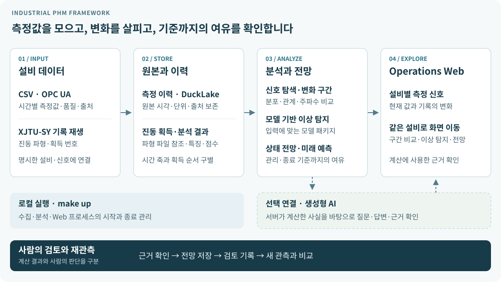

# Industrial PHM Framework

**설비 신호의 변화부터 기준까지 남은 여유, 사람의 검토까지.**

설비 운영자와 분석 담당자가 **측정값을 살펴보고, 이상 구간을 비교하고, 상태 변화를 전망**하는
Python 기반 PHM(Prognostics and Health Management) 프로젝트입니다.
CSV·OPC UA 측정 이력과 베어링 진동 기록을 같은 설비 중심의 Web에서 탐색합니다.

[실행 안내](#로컬에서-열어보기) · [내 데이터 연결](#내-데이터로-사용하기) · [사용법](apps/README.md) · [지원 범위](docs/status.md)

## 측정에서 검토까지



시간별 측정값은 **설비 이력**으로, 진동 파형은 **획득 기록**으로 보존합니다.
저장된 데이터에서 신호 변화·이상 점수·기준 도달 전망을 계산하고, 사용자는 같은 설비의 원본과 계산 근거를 확인합니다.
AI 질문은 선택 사항이며, 전망 저장과 사람의 검토·재관측 비교는 별도 행동입니다.

[구성 요소와 책임](docs/architecture/overview.md) · [상태 전망의 계산·검토 계약](docs/product/condition-and-rul-outlook.md)

## 화면에서 확인하는 결과

### 설비를 고르고 측정 변화를 확인


선택 설비의 측정 신호와 관련 이상 탐지 결과를 함께 봅니다. 신호 탐색으로 이동하면
과거·최근 구간의 분포, 신호 관계와 주파수 성분을 비교할 수 있습니다.

### 관리 기준과 종료 기준까지의 여유 비교


최근 변화와 이상 탐지 결과를 바탕으로, **입력한 기준까지의 여유가 예측 조건에 따라 어떻게 달라지는지** 확인합니다.
계산에 쓴 구간과 신호로 이동하고, 운영 실행 중에는 전망을 검토 대상으로 저장해 새 관측과 비교할 수 있습니다.

두 화면은 **XJTU-SY Bearing1_1 기록 재생 데이터**를 최신 Web의 조회 화면에서 캡처했습니다.
현장 실시간 수신이나 고장 예측 성능을 보여주는 사례는 아닙니다.
[촬영 조건](assets/README.md#화면-캡처) · [설정별 예측 화면](docs/product/forecast-flexibility-and-condition-outlook.md#설정별-화면-예시)

## 어떤 질문에 답할 수 있나요?

| 확인할 질문 | 사용하는 흐름 |
| --- | --- |
| 어떤 설비의 어느 신호를 봐야 하나요? | 설비 모니터링 → 확인 항목·측정 신호·최근 기록 |
| 과거와 최근에 무엇이 달라졌나요? | 신호 탐색 → 구간 A/B의 값·분포·관계·주파수 비교 |
| 기준 구간에서 벗어난 시점은 어디인가요? | 이상 탐지 → 모델 없는 변화 구간 탐색 또는 연결된 모델의 이상 점수 |
| 이 흐름이 이어지면 기준에 언제 닿나요? | 상태 전망 → 관리·종료 기준과 예측 설정별 시간·획득 수 비교 |
| 설명과 검토를 어떻게 이어가나요? | 선택적 AI 질문·근거 링크 → 전망 저장·사람 검토 → 재관측 비교 |

모델 기반 분석은 데이터와 입력 조건이 맞는 패키지를 연결해 사용합니다.
지원 조건과 검증 수준은 [현재 지원 상태](docs/status.md)를 기준으로 확인하세요.

## 내 데이터로 사용하기

1. **CSV부터 시작:** Web의 `데이터 연결`에서 파일을 고르고 시간·측정 컬럼을 지정합니다.
   미리보기와 서버 점검을 확인한 뒤 측정 이력을 저장합니다.
2. **같은 설비로 탐색:** 저장된 설비를 열어 측정 신호를 보고, 신호 탐색·이상 탐지·상태 전망으로 이동합니다.
   예측에는 선택 기간을 계산할 만큼의 기록이 필요합니다.
3. **기록 재생·설비 연결로 확장:** 진동 획득 데이터는 모델 패키지 연결과 기록 재생을,
   OPC UA는 소스·노드 매핑과 수집 설정을 따릅니다.

[CSV·OPC UA 연결 안내](apps/README.md#operations--supervised-web) ·
[XJTU-SY 모델 연결·재생](apps/README.md#이상-탐지-모니터링-xjtu-sy-기록-재생) ·
[AI-Hub 등 데이터 준비](data/README.md)

## 로컬에서 열어보기

**준비:** Linux, `make`, [uv](https://docs.astral.sh/uv/).
첫 실행은 Python 3.14와 잠긴 의존성(기본 LSTM 실행용 CPU PyTorch 포함)을 설치하므로 네트워크가 필요합니다.

```bash
git clone https://github.com/so9093-K/industrial-phm-framework.git
cd industrial-phm-framework
make up
```

준비가 끝나면 [http://127.0.0.1:2718/web/](http://127.0.0.1:2718/web/)를 엽니다.
빈 작업공간에서는 **예시 데이터로 둘러보기**로 먼저 탐색하거나 **파일에서 시작**으로 내 CSV를 연결합니다.
외부 데이터셋이나 AI 서버를 먼저 준비할 필요는 없습니다.

서비스는 실행한 터미널에서 동작합니다. 다른 터미널에서 상태·로그를 확인하거나 종료할 수 있습니다.

```bash
make status
make logs
make down
```

실행한 터미널에서 Ctrl-C로 종료해도 됩니다. 기본 작업공간은 `artifacts/operations`입니다.
다른 경로를 쓰려면 모든 명령에 같은 `WORKSPACE=/absolute/path`를 지정합니다.
[작업공간·상세 실행 방법](apps/README.md#operations--supervised-web)

## 적용 범위와 결과의 의미

- **로컬 단일 사용자:** Linux·CPython 3.14 기반의 loopback Web입니다. 원격 인증·TLS·다중 사용자 운영 범위는 [지원 상태](docs/status.md)를 확인하세요.
- **데이터별 조건:** CSV·OPC UA 측정 이력과 진동 획득은 입력·시간 축·모델 조건이 다릅니다. 공개 데이터의 연구 결과를 현장 성능으로 해석하지 않습니다.
- **조건부 전망:** 화면의 잔여수명은 사용자가 정한 **종료 기준까지의 여유**입니다. 검증된 물리적 고장 시각이나 자동 정비 지시를 뜻하지 않습니다.
- **선택적 AI:** 설정한 생성형 AI 서버가 없어도 측정 조회와 직접 분석은 가능합니다. 저장·모델 연결·AI 질문 등은 `make up`으로 운영을 실행한 화면에서 사용합니다.

## 목적에 맞는 문서 찾기

| 목적 | 진입점 |
| --- | --- |
| 실행·데이터 연결·모델 재생 | [Operations 사용법](apps/README.md) |
| 데이터셋 준비와 사용 조건 | [데이터 안내](data/README.md) |
| 기능별 지원 조건과 제한 | [현재 지원 상태](docs/status.md) |
| 데이터 흐름·저장·실행 책임 | [아키텍처](docs/architecture/overview.md) · [설계 결정](docs/adr/README.md) |
| 전망·AI 질문·검토의 의미 | [상태 전망 가이드](docs/product/condition-and-rul-outlook.md) |
| 연구 프로토콜·평가 결과 | [연구 안내](docs/research/README.md) |
| 개발 환경·검증·기여 | [기여 안내](CONTRIBUTING.md) · [변경 이력](CHANGELOG.md) |

## 라이선스

프로젝트 소스와 문서는 [Apache License 2.0](LICENSE)을 따릅니다.
데이터셋과 외부 모델은 각 제공자의 라이선스·사용 조건을 확인하세요.
