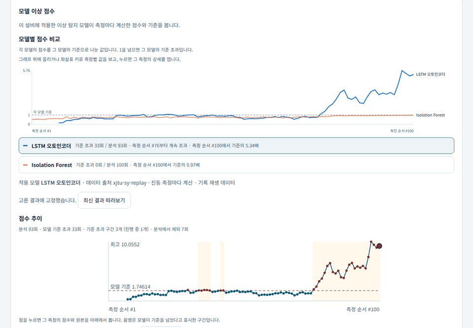
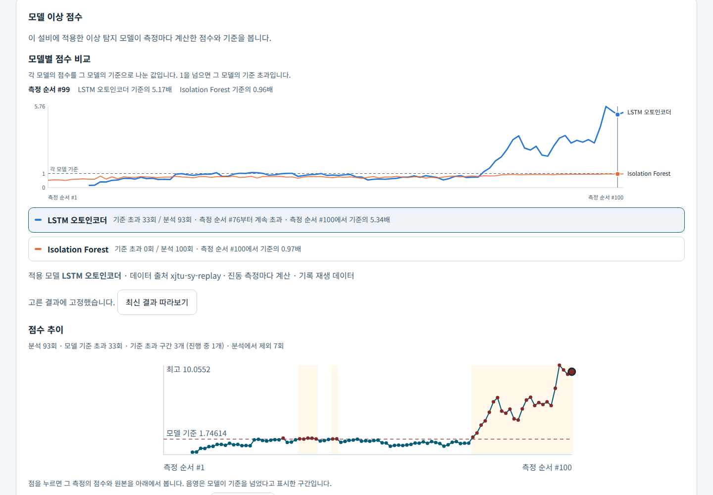
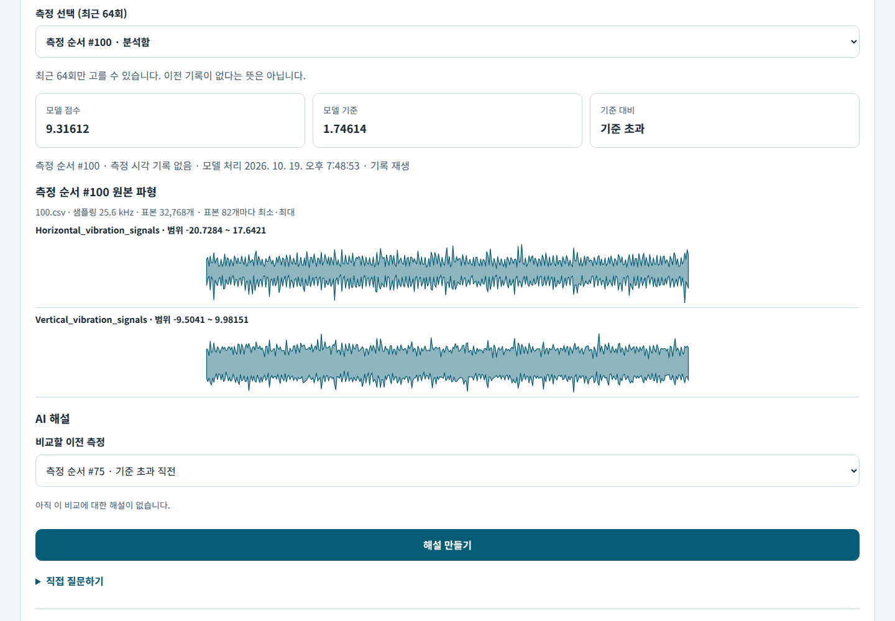
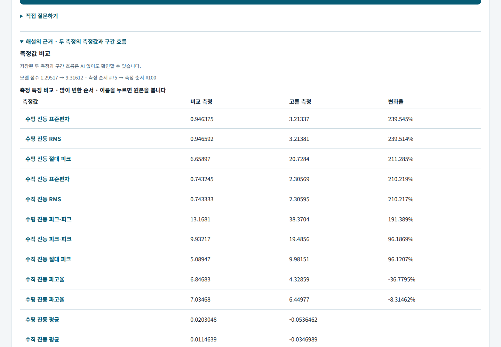
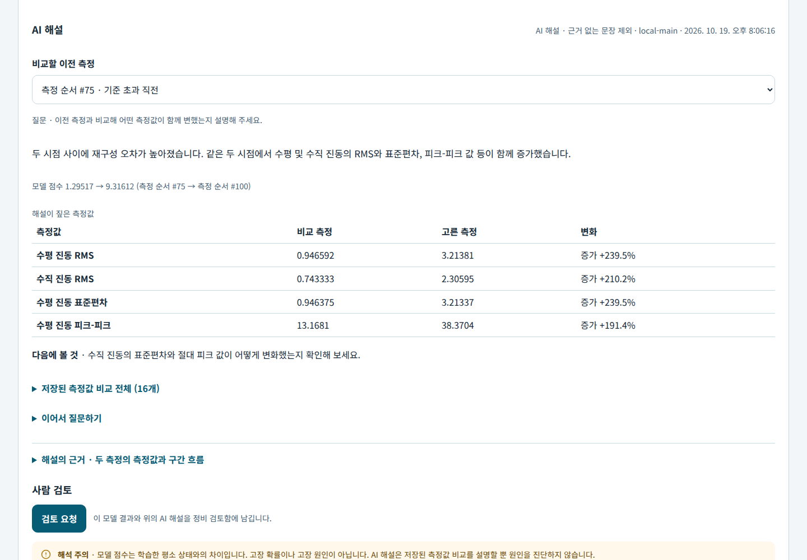
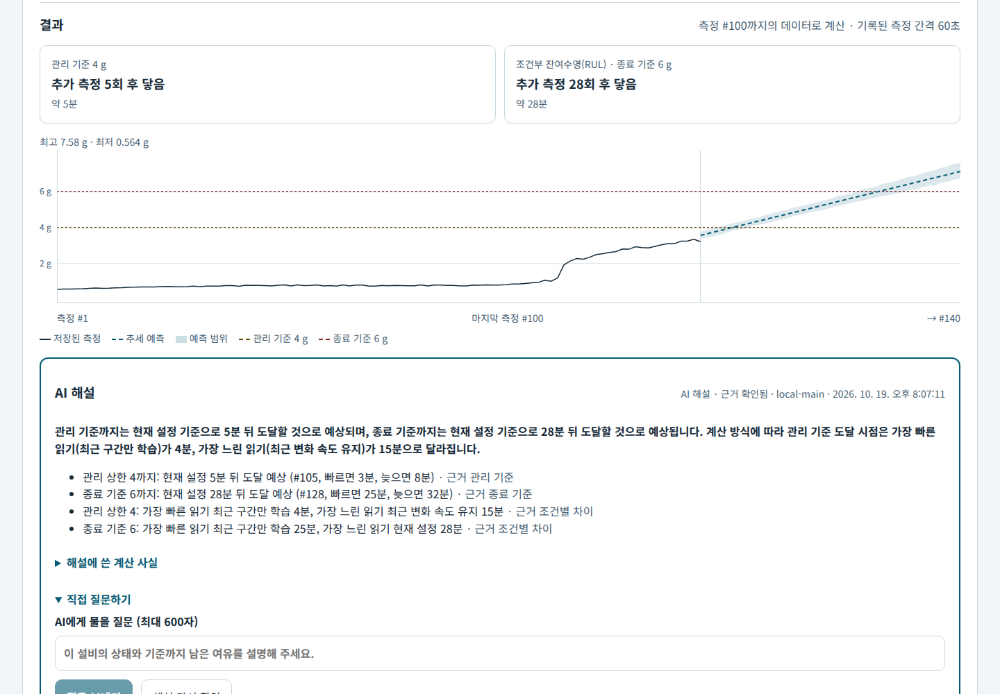
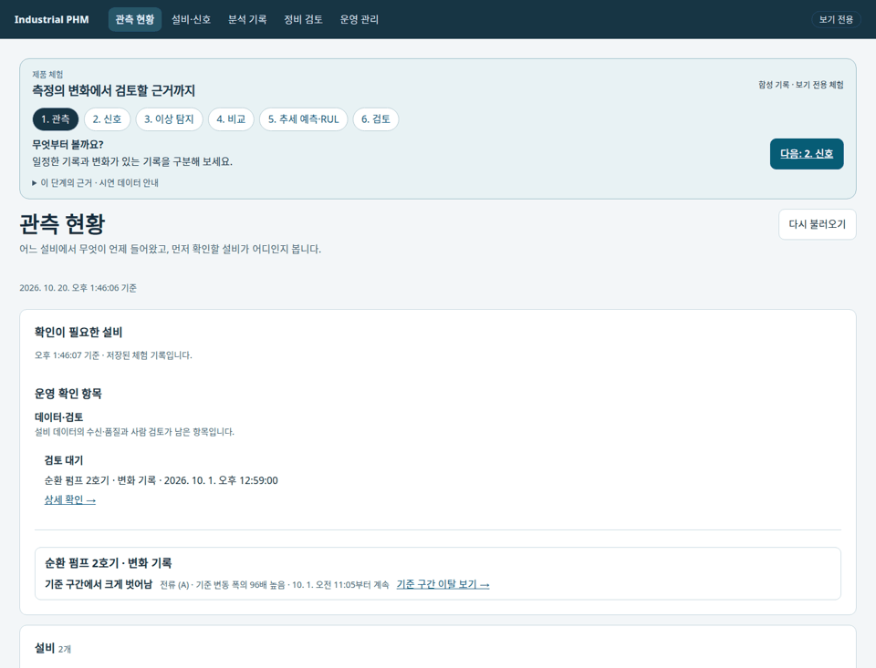

# Industrial PHM Framework

**설비 데이터 모니터링·이상 탐지 모델·AI 해설·상태 전망**

설비 운영자와 분석 담당자가 측정값과 이상 탐지 모델의 점수를 함께 보고, 무엇이 변했는지 원본으로 확인하고,
AI에게 묻고, 검토를 남기는 Python 기반 PHM(Prognostics and Health Management) 애플리케이션입니다.
CSV 파일·OPC UA 수신 데이터·베어링 진동 기록을 설비별 웹 화면에서 조회하고 분석합니다.

[이상 탐지에서 RUL까지](#이상-탐지에서-rul까지) · [설치 없이 둘러보기](#설치-없이-둘러보기) · [빠른 시작](#빠른-시작) · [데이터 연결](#데이터-연결) · [사용법](apps/README.md) · [지원 범위](docs/status.md)

## 이상 탐지에서 RUL까지

XJTU-SY 베어링 수명 시험 기록 중 모델 학습에 쓰지 않은 **Bearing1_1**을 측정 #100까지 재생한 실제 화면입니다.
**Isolation Forest**와 **LSTM 오토인코더**가 측정마다 점수를 매기고, 같은 진동 특징을 **Prophet**으로 예측해
사용자가 정한 기준까지 남은 시간(조건부 잔여수명, RUL)을 계산합니다. 해설은 로컬 AI 서버(`local-main`)의 실제 응답입니다.



### 두 모델은 같은 변화를 잡았나요?



각 모델의 점수를 그 모델의 기준으로 나눠 한 축에 그립니다. LSTM 오토인코더는 측정 #76부터 계속 기준을 넘어
#100에서 기준의 5.3배이고, Isolation Forest는 점수가 오르고 있지만 아직 기준 아래(0.97배)입니다.
그래프의 한 지점을 누르면 그 측정을 열고, 모델을 바꿔도 같은 측정을 유지합니다.

### 그 측정에서 무엇이 달라졌나요?





측정을 고르면 점수와 원본 파형이 열리고, 기준 초과 구간 안의 측정은 그 구간 직전 측정(#75)과 비교합니다.
수평 진동 RMS는 0.95 g에서 3.21 g로(+240%), 수직 진동 RMS는 0.74 g에서 2.31 g로(+210%) 커졌습니다. 각 변화 지점은 원본 파형으로 바로 확인합니다.

### AI에게 무엇이 변했는지 묻습니다



해설의 수치는 저장된 비교에서 가져오고, 근거가 확인되지 않는 문장은 뺍니다. 이어서 질문할 수 있으며,
AI 서버가 없을 때는 저장된 비교로 같은 형식의 해설을 만듭니다.

### 이대로 가면 언제 기준에 닿나요?



비교표에서 고른 특징의 `기준 도달 전망`으로 이어집니다. 수평 진동 RMS의 추세를 Prophet으로 예측하면,
입력한 관리 기준 4 g에는 추가 측정 5회 후(약 5분), 종료 기준 6 g에는 28회 후(약 28분) 닿습니다. 이 28분이 종료 기준까지의
조건부 잔여수명(RUL)입니다. 측정 간격(60초)이 기록돼 있어 시간으로도 환산하고, 그래프 축과 기준은 진동 진폭 단위(g)로 읽습니다. 남은 시간을 물으면 해설이 계산 방식에 따른 차이(25~32분)도 함께 짚습니다.
결과와 해설은 `검토 요청`으로 정비 검토함에 남기고, 사람이 확인한 뒤 종료합니다.

### 직접 실행

[XJTU-SY 원본](data/README.md#xjtu-sy)을 준비한 뒤 한 명령으로 두 모델을 학습 베어링으로 맞추고(처음 한 번, 몇 분),
측정 #100까지 재생하고 Web을 엽니다. [http://127.0.0.1:2718/web/](http://127.0.0.1:2718/web/) → Bearing1_1 → 이상 징후.

```bash
uv sync --locked --extra operations
uv run industrial-phm demo xjtu --until 100     # --until 없이 실행하면 전체 기록(#123), --bearing으로 다른 베어링
```

다른 터미널에서 나머지 측정을 이어서 넣으면 점수가 갱신되고, 같은 조건으로 전망을 다시 계산할 수 있습니다.

```bash
uv run industrial-phm operations phm replay-xjtu artifacts/demo-xjtu \
  --source data/interim/xjtu-sy/XJTU-SY_Bearing_Datasets --bearing Bearing1_1 --start 101 --interval-seconds 5
```

XJTU-SY 원본은 이 저장소에서 재배포하지 않습니다(Wang et al., IEEE Trans. Reliability, 2020,
[doi:10.1109/TR.2018.2882682](https://doi.org/10.1109/TR.2018.2882682)).
모델 학습 범위·평가 기록은 [운영 추론 수용 프로토콜](docs/research/operational-inference-acceptance-protocol.md)에 있습니다.

## 설치 없이 둘러보기

데이터셋·Python 없이 합성 펌프 기록으로 **관측 → 신호 → 기준 구간 이탈 → 두 기간 비교 → 추세 예측·RUL → 검토 기록**을 따라갑니다.
학습 모델이 없는 설비에 쓰는 분석들입니다. 기준 구간 이탈은 기준 구간의 중앙값과 변동 폭(MAD)으로 벗어난 시점을 찾습니다.



Node.js 22.12 이상과 npm으로 실행하고 [http://127.0.0.1:2720/web/](http://127.0.0.1:2720/web/)를 엽니다.

```bash
make showcase
```

보기 전용 정적 배포물이라 준비된 조건만 열립니다. 새 조건을 계산하거나 기록하려면 아래 Operations 실행을 사용합니다.
[화면 6장과 촬영 조건](assets/README.md#합성-데이터-체험) · [시연 데이터·재생성](docs/product/product-showcase.md)

## 주요 기능 및 사용 사례

| 기능 | 사용 방법 |
| --- | --- |
| 측정 상태 확인 | 설비를 선택해 마지막 측정 시각·신호 추세·분석 결과 확인 |
| 이상 탐지 | 연결한 모델(Isolation Forest·LSTM 오토인코더·PCA 잔차)의 측정별 점수와 모델 간 비교, 원본 파형·특징 변화 확인. 모델이 없으면 기준 구간 이탈 |
| 구간 비교 | 두 구간을 지정해 값 분포·신호 간 관계 비교, 진동 파형의 주파수 성분 확인 |
| 상태 전망·RUL | 선택 신호의 미래 값과 사용자가 정한 관리·종료 기준까지 남은 시간 |
| AI 해설·검토 기록 | 모델 결과·전망에 대한 질문, 검토 요청·확인·종료, 나중 측정값과 비교 |

모델 분석에는 입력 형식이 맞는 모델 패키지가 필요합니다. AI 질문과 저장·검토 기능은 운영 실행 중에 사용합니다.
지원 조건은 [현재 지원 상태](docs/status.md)를 기준으로 확인하세요.

## 데이터 연결

1. **CSV 파일 등록:** 웹의 `데이터 연결`에서 파일을 고르고 시각·측정값 열을 지정합니다.
   미리보기와 서버 점검을 확인한 뒤 측정 이력을 저장합니다.
2. **측정 조회·분석:** 등록한 설비를 선택하고 신호 탐색·이상 탐지·상태 전망 화면을 엽니다.
   시계열 예측에는 계산에 사용하는 측정값이 20개 이상이고, 기록 기간이 예측 기간의 2배 이상이어야 합니다.
3. **다른 데이터 연결:** 베어링 진동 기록은 모델 패키지 연결·기록 재생 안내를,
   OPC UA 수신은 데이터 출처·노드 매핑과 수집 설정 안내를 따릅니다.

[CSV·OPC UA 연결 안내](apps/README.md#operations--supervised-web) ·
[XJTU-SY 모델 연결·재생](apps/README.md#이상-탐지-모니터링-xjtu-sy-기록-재생) ·
[AI-Hub 등 데이터 준비](data/README.md)

## 빠른 시작

**macOS 준비:** `make`, 실행 중인 Docker Desktop과 Docker Compose.
`make up`은 Linux 컨테이너 안에서 수집·분석·Web·DuckLake를 함께 실행합니다.
호스트에 Python·uv·Node를 설치하거나 Docker의 host networking을 켤 필요가 없습니다.

**Linux 네이티브 준비:** `make`, [uv](https://docs.astral.sh/uv/), Node.js 22.12 이상과 npm.
Linux의 `make up`은 잠금 파일 기준으로 Web 화면을 빌드하고 Python 3.14 의존성을 설치해 실행합니다.
Linux에서도 `make container-up`으로 같은 컨테이너 구성을 사용할 수 있습니다.
첫 빌드는 CPU PyTorch를 포함한 의존성과 이미지를 내려받으므로 네트워크와 수 분이 필요합니다.

```bash
git clone https://github.com/so9093-K/industrial-phm-framework.git
cd industrial-phm-framework
make up
```

준비가 끝나면 [http://127.0.0.1:2718/web/](http://127.0.0.1:2718/web/)를 엽니다.
빈 작업공간의 첫 화면에서 **CSV 파일로 시작**으로 파일을 연결하거나, **예시로 둘러보기**로 분리된 예시 작업공간의 화면을 확인합니다.
외부 데이터셋이나 AI 서버를 먼저 준비할 필요는 없습니다.

macOS의 컨테이너는 백그라운드에서, Linux 네이티브 서비스는 실행한 터미널에서 동작합니다.
상태·로그를 확인하거나 종료할 수 있습니다.

```bash
make status
make logs
make down
```

컨테이너 작업공간은 `industrial-phm_workspace` Docker 볼륨에 보존되며 `make down` 후에도 유지됩니다.
호스트의 `artifacts/operations`와는 별개입니다. 기존 호스트 데이터를 자동으로 가져오지 않습니다.
컨테이너 실행·백업·AI 연결의 범위는 [컨테이너 실행 안내](docs/architecture/operations-container.md)를 참고하세요.

Linux 네이티브 서비스는 Ctrl-C로 종료해도 됩니다. 기본 작업공간은 `artifacts/operations`입니다.
네이티브 실행에 다른 경로를 쓰려면 모든 명령에 같은 `WORKSPACE=/absolute/path`를 지정합니다.
[작업공간·상세 실행 방법](apps/README.md#operations--supervised-web)

## 지원 환경 및 제약

- **실행 환경:** Linux·CPython 3.14 또는 macOS의 Docker Desktop(Linux 컨테이너), 로컬 단일 사용자용입니다. 원격 인증·TLS·다중 사용자 운영은 미지원입니다.
- **이상 탐지 해석:** 비교 구간에서 벗어났거나 모델 점수가 기준을 넘었다는 결과만으로 설비 고장을 확정할 수 없습니다.
- **예측 해석:** 기준선 도달 시점은 선택한 신호·학습 구간·예측 설정에 따른 계산값입니다.
  상태 전망 화면의 `잔여수명`도 사용자가 입력한 종료 기준까지의 계산값이며, 실제 고장 시각을 검증한 결과가 아닙니다.
- **시간 환산:** 진동 측정 간격이 기록돼 있거나 사용자가 가정한 경우에만 도달 시점을 시간으로 환산합니다.
  간격을 모르면 추가 측정 횟수로 표시합니다.

## 시스템 구성


운영 데이터 흐름과 분석 구조를 나타낸 개념도입니다. 기능별 구현·지원 조건은 [현재 지원 상태](docs/status.md)를 확인하세요.

CSV·OPC UA 측정값은 시각·출처와 함께 저장합니다. 베어링 진동 기록은
여러 샘플이 담긴 파형 한 묶음을 측정 1회로 다룹니다.
웹 화면에서 저장된 데이터의 두 구간을 비교하거나, 연결된 모델의 이상 점수와 선택 신호의 예측값을 확인합니다.
AI 설명에는 별도 모델 서버 연결이 필요합니다. 사용자는 상태 전망의 계산 결과를 검토 요청으로 저장하고 확인·종료할 수 있습니다.

[구성 요소와 데이터 흐름](docs/architecture/overview.md) · [상태 전망 계산과 검토 기능](docs/product/condition-and-rul-outlook.md)

## 상세 문서

| 목적 | 진입점 |
| --- | --- |
| 실행·데이터 연결·모델 재생 | [Operations 사용법](apps/README.md) |
| 데이터셋 준비와 사용 조건 | [데이터 안내](data/README.md) |
| 기능별 지원 조건과 제한 | [현재 지원 상태](docs/status.md) |
| 데이터 흐름·저장·실행 책임 | [아키텍처](docs/architecture/overview.md) · [설계 결정](docs/adr/README.md) |
| 전망·AI 질문·검토의 의미 | [상태 전망 가이드](docs/product/condition-and-rul-outlook.md) |
| 연구 프로토콜·평가 결과 | [연구 안내](docs/research/README.md) |
| 개발 환경·검증·기여 | [기여 안내](CONTRIBUTING.md) · [변경 이력](CHANGELOG.md) |

## 라이선스

프로젝트 소스와 문서는 [Apache License 2.0](LICENSE)을 따릅니다.
데이터셋과 외부 모델은 각 제공자의 라이선스·사용 조건을 확인하세요.
