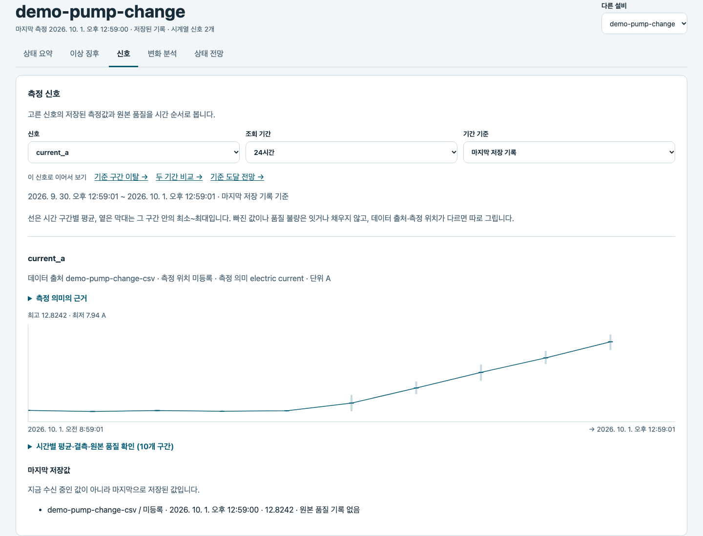
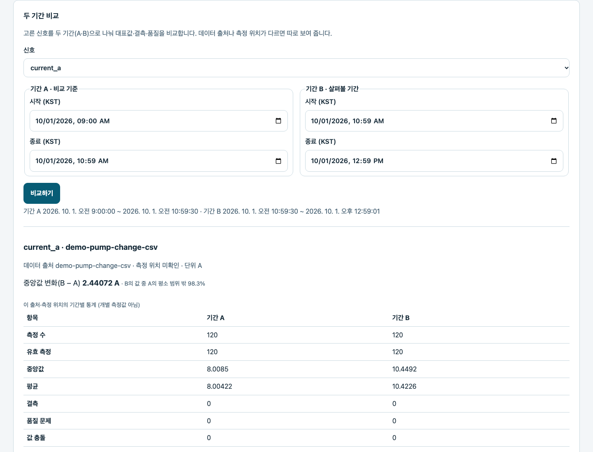
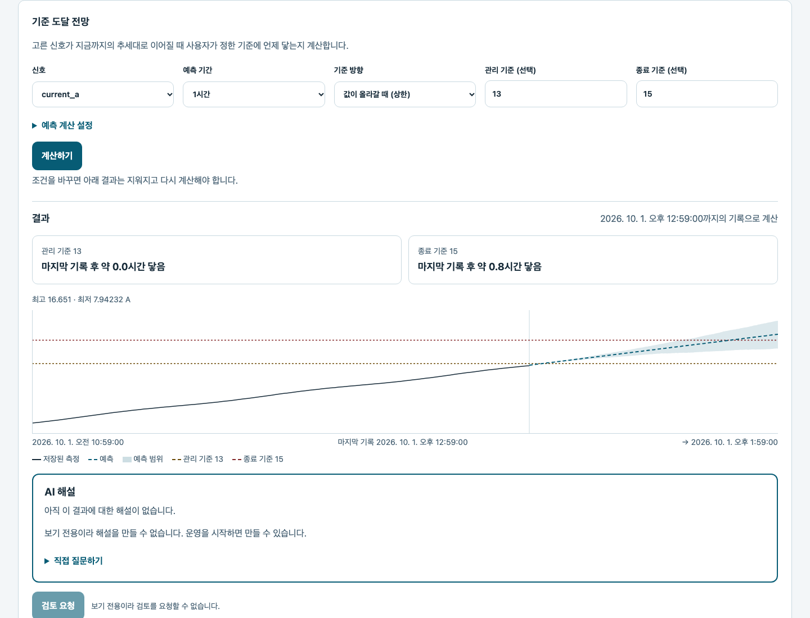

# Industrial PHM Framework

**설비 데이터 모니터링·구간 비교·이상 탐지·시계열 예측**

설비 운영자와 분석 담당자가 저장된 측정값과 분석 결과를 확인하는
Python 기반 PHM(Prognostics and Health Management) 애플리케이션입니다.
CSV 파일·OPC UA 수신 데이터·베어링 진동 기록을 설비별 웹 화면에서 조회하고 분석합니다.

[분석 흐름 체험](#분석-흐름-체험) · [빠른 시작](#빠른-시작) · [데이터 연결](#데이터-연결) · [사용법](apps/README.md) · [지원 범위](docs/status.md)

## 분석 흐름 체험

**관측 → 신호 → 두 기간 비교 → 조건부 전망 → 검토 기록**을 현재 제품 화면에서 따라갑니다.
전류와 온도가 함께 증가하도록 만든 합성 펌프와 일정한 합성 펌프를 비교합니다.


[시연 영상(WebM)](assets/showcase/walkthrough.webm) · [화면 5장과 촬영 조건](assets/README.md#현재-제품-체험) ·
[시연 데이터·재생성·검증](docs/product/product-showcase.md)

Node.js 22.12 이상과 npm이 있으면 저장소에서 다음 명령으로 체험할 수 있습니다.
Python·Docker·데이터셋·AI 서버 설치 없이 [http://127.0.0.1:2720/web/](http://127.0.0.1:2720/web/)를 엽니다.

```bash
make showcase
```

체험은 실제 애플리케이션으로 저장·분석한 결과를 읽는 **보기 전용 정적 배포물**입니다.
설비·신호·기록 기간·기준 구간을 바꿔 보고, 준비된 전망을 열거나 저장된 검토 메모를 확인할 수 있습니다.
임의의 조건을 새로 계산하거나 기록하려면 아래의 전체 Operations 실행을 사용합니다.
CI의 [Product showcase 배포물](https://github.com/so9093-K/industrial-phm-framework/actions/workflows/product-showcase.yml)은
일반 정적 HTTP 호스팅에서도 실행할 수 있습니다. 공개 체험 사이트는 아직 배포하지 않았습니다.

## 주요 화면

### 어떤 측정값이 변했나요?



측정값과 단위·출처·시각을 함께 확인합니다. 체험의 전류·온도는 1분 간격으로 생성한 입력이며 실제 계측값이 아닙니다.

### 변화의 크기와 근거를 확인합니다



두 기간의 중앙값과 유효한 측정 수를 나란히 봅니다. A는 비교할 구간이며 검증된 정상 기준이 아닙니다.

### 지금 추세가 이어진다면?



현재 기록으로 예측과 기준 도달 전망을 계산했습니다. **13 A·15 A는 시연용 임의 기준**이며
실제 설비의 허용값이나 고장 시각을 검증한 결과가 아닙니다. AI 답변이나 학습 모델의 성능을 보여주는 체험도 아닙니다.

## 주요 기능 및 사용 사례

| 기능 | 사용 방법 |
| --- | --- |
| 측정 상태 확인 | 설비를 선택해 마지막 측정 시각·신호 추세·분석 결과 확인 |
| 구간 비교 | 두 구간을 지정해 값 분포·신호 간 관계 비교, 진동 파형의 주파수 성분 확인 |
| 이상 탐지 | 측정값을 선택한 기준 구간과 비교하거나, 연결한 모델의 이상 점수 확인 |
| 시계열 예측 | 선택 신호의 미래 값과 입력한 기준선의 예상 도달 시점 확인 |
| AI 설명·검토 기록 | 분석 내용 질문, 상태 전망 저장, 검토 메모 작성, 나중 측정값과 비교 |

모델 기반 분석에는 입력 조건이 일치하는 모델 패키지가 필요합니다. AI 질문과 저장·검토 기능은 운영 실행 중에 사용합니다.
지원 조건과 검증 수준은 [현재 지원 상태](docs/status.md)를 기준으로 확인하세요.

## 데이터 연결

1. **CSV 파일 등록:** 웹의 `데이터 연결`에서 파일을 고르고 시각·측정값 열을 지정합니다.
   미리보기와 서버 점검을 확인한 뒤 측정 이력을 저장합니다.
2. **측정 조회·분석:** 등록한 설비를 선택하고 신호 탐색·이상 탐지·상태 전망 화면을 엽니다.
   시계열 예측에는 계산에 사용하는 측정값이 20개 이상이고, 기록 기간이 예측 기간의 2배 이상이어야 합니다.
3. **다른 데이터 연결:** 베어링 진동 기록은 모델 패키지 연결·기록 재생 안내를,
   OPC UA 수신은 데이터 출처·노드 매핑과 수집 설정 안내를 따릅니다.

[CSV·OPC UA 연결 안내](apps/README.md#operations--supervised-web) ·
[XJTU-SY 모델 연결·재생](apps/README.md#이상-탐지-모니터링-xjtu-sy-기록-재생) ·
[AI-Hub 등 데이터 준비](data/README.md)

## 빠른 시작

**macOS 준비:** `make`, 실행 중인 Docker Desktop과 Docker Compose.
`make up`은 Linux 컨테이너 안에서 수집·분석·Web·DuckLake를 함께 실행합니다.
호스트에 Python·uv·Node를 설치하거나 Docker의 host networking을 켤 필요가 없습니다.

**Linux 네이티브 준비:** `make`, [uv](https://docs.astral.sh/uv/), Node.js 22.12 이상과 npm.
Linux의 `make up`은 잠금 파일 기준으로 Web 화면을 빌드하고 Python 3.14 의존성을 설치해 실행합니다.
Linux에서도 `make container-up`으로 같은 컨테이너 구성을 사용할 수 있습니다.
첫 빌드는 CPU PyTorch를 포함한 의존성과 이미지를 내려받으므로 네트워크와 수 분이 필요합니다.

```bash
git clone https://github.com/so9093-K/industrial-phm-framework.git
cd industrial-phm-framework
make up
```

준비가 끝나면 [http://127.0.0.1:2718/web/](http://127.0.0.1:2718/web/)를 엽니다.
빈 작업공간의 첫 화면에서 **CSV 파일로 시작**으로 파일을 연결하거나, **예시로 둘러보기**로 분리된 예시 작업공간의 화면을 확인합니다.
외부 데이터셋이나 AI 서버를 먼저 준비할 필요는 없습니다.

macOS의 컨테이너는 백그라운드에서, Linux 네이티브 서비스는 실행한 터미널에서 동작합니다.
상태·로그를 확인하거나 종료할 수 있습니다.

```bash
make status
make logs
make down
```

컨테이너 작업공간은 `industrial-phm_workspace` Docker 볼륨에 보존되며 `make down` 후에도 유지됩니다.
호스트의 `artifacts/operations`와는 별개입니다. 기존 호스트 데이터를 자동으로 가져오지 않습니다.
컨테이너 실행·백업·AI 연결의 범위는 [컨테이너 실행 안내](docs/architecture/operations-container.md)를 참고하세요.

Linux 네이티브 서비스는 Ctrl-C로 종료해도 됩니다. 기본 작업공간은 `artifacts/operations`입니다.
네이티브 실행에 다른 경로를 쓰려면 모든 명령에 같은 `WORKSPACE=/absolute/path`를 지정합니다.
[작업공간·상세 실행 방법](apps/README.md#operations--supervised-web)

## 지원 환경 및 제약

- **실행 환경:** Linux·CPython 3.14 또는 macOS의 Docker Desktop(Linux 컨테이너), 로컬 단일 사용자용입니다. 원격 인증·TLS·다중 사용자 운영은 미지원입니다.
- **이상 탐지 해석:** 비교 구간에서 벗어났거나 모델 점수가 기준을 넘었다는 결과만으로 설비 고장을 확정할 수 없습니다.
- **예측 해석:** 기준선 도달 시점은 선택한 신호·학습 구간·예측 설정에 따른 계산값입니다.
  상태 전망 화면의 `잔여수명`도 사용자가 입력한 종료 기준까지의 계산값이며, 실제 고장 시각을 검증한 결과가 아닙니다.
- **시간 환산:** 진동 측정 간격이 기록돼 있거나 사용자가 가정한 경우에만 도달 시점을 시간으로 환산합니다.
  간격을 모르면 추가 측정 횟수로 표시합니다.

## 시스템 구성


운영 데이터 흐름과 분석 구조를 나타낸 개념도입니다. 기능별 구현·지원 조건은 [현재 지원 상태](docs/status.md)를 확인하세요.

CSV·OPC UA 측정값은 시각·출처와 함께 저장합니다. 베어링 진동 기록은
여러 샘플이 담긴 파형 한 묶음을 측정 1회로 다룹니다.
웹 화면에서 저장된 데이터의 두 구간을 비교하거나, 연결된 모델의 이상 점수와 선택 신호의 예측값을 확인합니다.
AI 설명에는 별도 모델 서버 연결이 필요합니다. 사용자는 상태 전망의 계산 결과를 저장하고 검토 메모를 남길 수 있습니다.

[구성 요소와 데이터 흐름](docs/architecture/overview.md) · [상태 전망 계산과 검토 기능](docs/product/condition-and-rul-outlook.md)

## 상세 문서

| 목적 | 진입점 |
| --- | --- |
| 실행·데이터 연결·모델 재생 | [Operations 사용법](apps/README.md) |
| 데이터셋 준비와 사용 조건 | [데이터 안내](data/README.md) |
| 기능별 지원 조건과 제한 | [현재 지원 상태](docs/status.md) |
| 데이터 흐름·저장·실행 책임 | [아키텍처](docs/architecture/overview.md) · [설계 결정](docs/adr/README.md) |
| 전망·AI 질문·검토의 의미 | [상태 전망 가이드](docs/product/condition-and-rul-outlook.md) |
| 연구 프로토콜·평가 결과 | [연구 안내](docs/research/README.md) |
| 개발 환경·검증·기여 | [기여 안내](CONTRIBUTING.md) · [변경 이력](CHANGELOG.md) |

## 라이선스

프로젝트 소스와 문서는 [Apache License 2.0](LICENSE)을 따릅니다.
데이터셋과 외부 모델은 각 제공자의 라이선스·사용 조건을 확인하세요.
