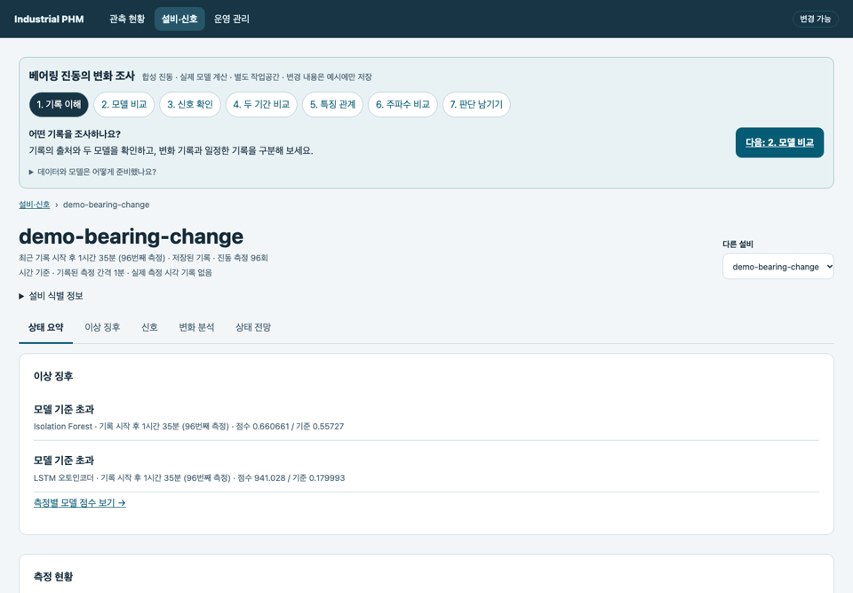
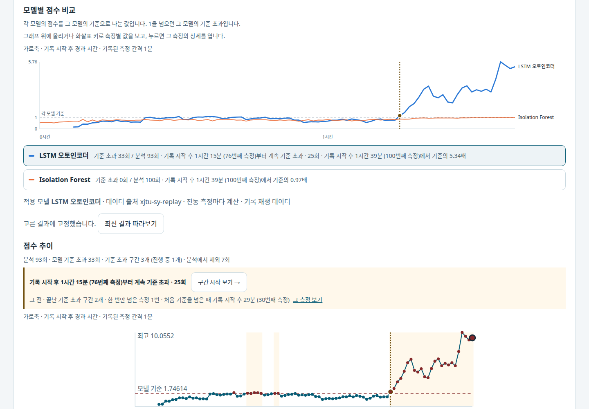
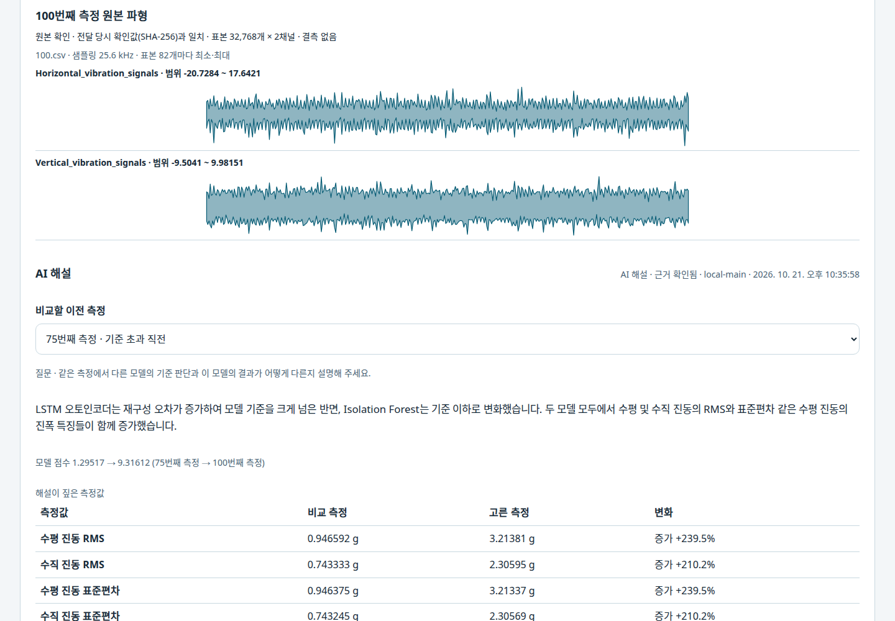
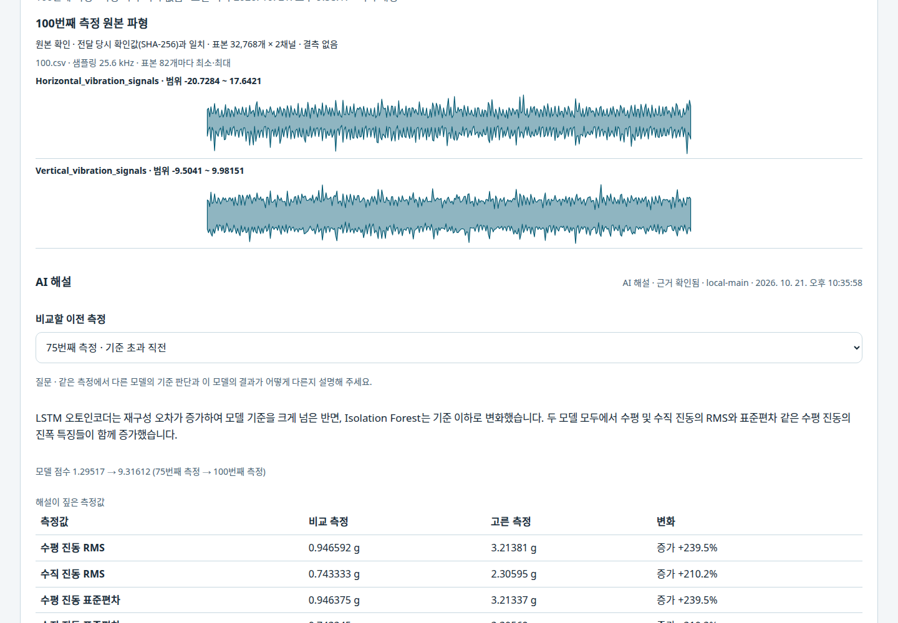
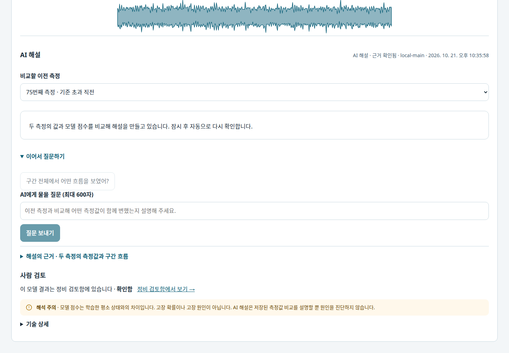
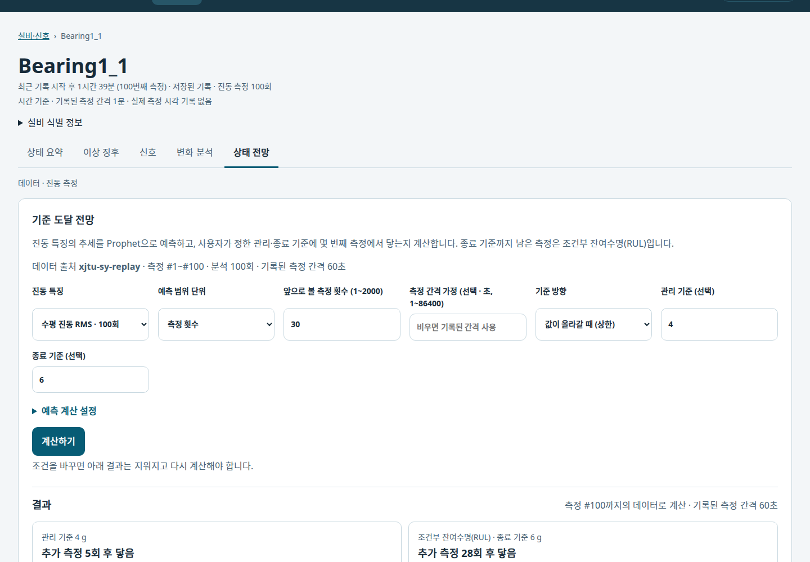
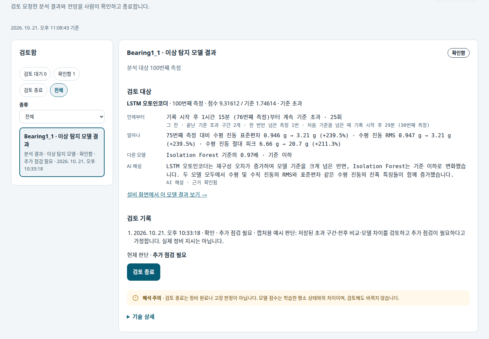
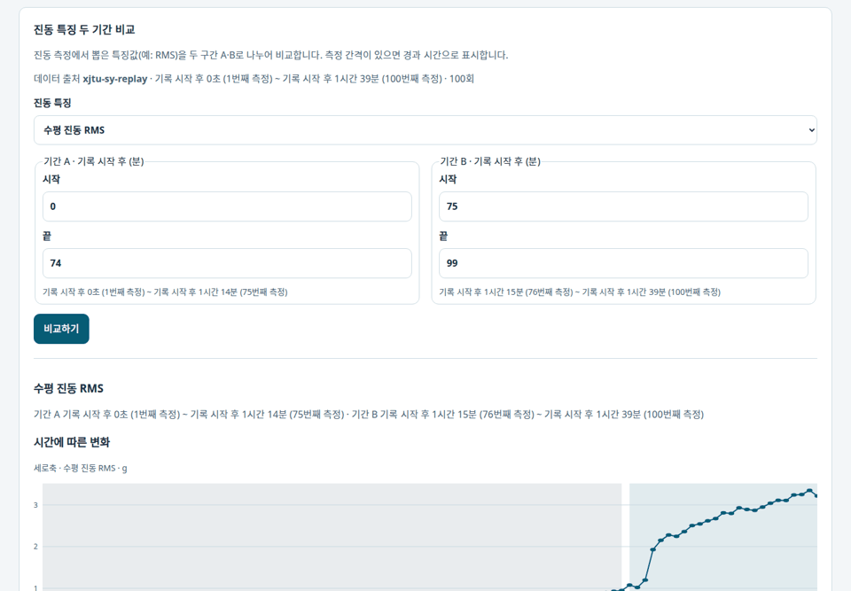

# Industrial PHM Framework

**설비 데이터 모니터링·이상 탐지 모델·AI 해설·상태 전망(RUL)**

CSV 파일·OPC UA 수신 데이터·베어링 진동 기록을 설비별 웹 화면에서 봅니다. 이상 탐지 모델의 점수로 변화를 찾고,
원본 신호와 비교하고, AI에게 무엇이 변했는지 묻고, 사용자가 정한 기준까지 남은 시간을 계산하는
Python 기반 PHM(Prognostics and Health Management) 애플리케이션입니다. 기본 메뉴는 관측·설비 분석·운영 관리이며,
분석 결과를 별도로 보관하고 사람의 판단을 기록하는 업무는 필요한 경우에만 열 수 있습니다.

[이상 탐지와 RUL](#이상-탐지와-rul) · [변화 분석](#변화-분석) · [CSV·실시간 수신](#csv-등록과-실시간-수신) · [설치 없는 체험](#설치-없는-체험) · [빠른 시작](#빠른-시작) · [사용법](apps/README.md) · [지원 범위](docs/status.md)

## 데이터 없이 분석 체험하기

`make up` 후 첫 화면의 **분석 체험하기 → 베어링 분석 체험 시작**을 선택합니다.
별도 데이터셋이나 AI 서버 없이, 분리된 예시 작업공간에서 다음 흐름을 따라갑니다.

**기록 이해 → 두 모델 비교 → 원본·특징 확인 → 두 기간 분포 → 특징 관계 → 주파수 비교 → 판단 기록**



일정한 기록과 후반부에 변화를 넣은 기록을 각각 96회 준비하고, 별도 합성 참조로 학습한
Isolation Forest·LSTM 오토인코더로 실제 분석합니다. 고른 모델·측정·특징·A/B 구간은 다음 단계에도 이어집니다.
그래프와 결과는 기존 분석 화면에서 조회·재계산하며, 검토 판단은 예시 작업공간에만 저장합니다.

입력과 모델 학습은 체험용 합성 데이터입니다. 아래 XJTU-SY 실기록 모델의 검증 결과나 실제 고장 사례로 해석하지 않습니다.
[체험 데이터와 재현 범위](docs/product/data-first-start.md#데이터-없는-첫-사용-베어링-분석-체험).

## 이상 탐지와 RUL

XJTU-SY 베어링 수명 시험 기록 중 모델 학습에 쓰지 않은 Bearing1_1을 측정 #100까지 재생한 화면입니다.


### 1. 모델별 점수 비교



Isolation Forest와 LSTM 오토인코더의 점수를 각 모델의 기준으로 나눠 한 축에 그립니다. 어느 모델이 언제부터
기준을 넘었는지 보고, 그래프의 한 지점을 누르면 그 측정을 엽니다. 모델을 바꿔도 보던 측정은 그대로입니다.

### 2. 측정 확인





고른 측정의 점수·기준과 원본 진동 파형을 봅니다. 기준 초과 구간의 측정은 구간 직전 측정과 진동 특징을 비교합니다.

### 3. AI 해설



같은 비교를 근거로 무엇이 변했는지 설명합니다. 수치는 저장된 비교에서 가져오고, 근거가 확인되지 않는 문장은 뺍니다.
이어서 질문할 수 있습니다.

### 4. 상태 전망·RUL



고른 진동 특징을 Prophet으로 예측해 사용자가 정한 관리 기준·종료 기준까지 남은 측정 수와 시간을 계산합니다.
종료 기준까지 남은 시간이 조건부 잔여수명(RUL)입니다. 기본 화면에서는 측정·모델 점수·전망을 확인합니다.
별도의 기록이 필요할 때만 `검토 기록에 남기기 (선택)`을 펼쳐 정비 검토함에 저장할 수 있습니다.

### 5. 별도 검토 판단 (선택)



필요할 때만 ‘추가 점검 필요 / 계속 관찰 / 점검 불필요’ 중 사람의 판단과 이유를 별도로 남깁니다.
사진의 판단은 촬영용 예시이며 실제 정비 지시나 수행 기록이 아닙니다.

### 직접 실행

[XJTU-SY 원본](data/README.md#xjtu-sy)을 준비한 뒤 실행합니다. 처음 한 번은 두 모델을 학습 베어링으로 맞추느라 몇 분 걸립니다.
실행 후 [http://127.0.0.1:2718/web/](http://127.0.0.1:2718/web/) → Bearing1_1 → 이상 징후를 엽니다.

```bash
uv sync --locked --extra operations
uv run industrial-phm demo xjtu --until 100     # --until 없이 실행하면 전체 기록(#123), --bearing으로 다른 베어링
```

나머지 측정을 이어서 넣으면 점수가 갱신되고, 같은 조건으로 전망을 다시 계산할 수 있습니다.

```bash
uv run industrial-phm operations phm replay-xjtu artifacts/demo-xjtu \
  --source data/interim/xjtu-sy/XJTU-SY_Bearing_Datasets --bearing Bearing1_1 --start 101 --interval-seconds 5
```

운영 화면(`make up`)의 **분석 체험하기 → 실제 데이터로 분석 시작**에서 같은 기록을 열려면 작업공간을 준비만 한 뒤
`compose.xjtu.yaml`로 연결합니다. 저장소 루트에서 실행하며, 원본은 읽기 전용으로 연결하고 이미지에 넣지 않습니다.

```bash
uv run industrial-phm demo xjtu --until 100 --workspace artifacts/demo-xjtu-ui --prepare-only
docker compose --env-file /dev/null -f compose.yaml -f compose.xjtu.yaml up -d --build
```

XJTU-SY 원본은 이 저장소에서 재배포하지 않습니다(Wang et al., IEEE Trans. Reliability, 2020,
[doi:10.1109/TR.2018.2882682](https://doi.org/10.1109/TR.2018.2882682)).

## 변화 분석



두 기간의 특징 분포, 같은 측정의 특징 관계, 원본 파형의 주파수별 세기를 비교합니다.
축 이름·단위·눈금과 A/B 구간을 함께 표시하며, 진동 기록은 기록된 측정 간격에 따른 경과 시간으로 읽습니다.
[각 화면과 비교 조건](assets/README.md#변화-분석).

## CSV 등록과 실시간 수신

진동 모델 외에도 파일 기록과 실시간 수신으로 시작할 수 있습니다.

| 입력 | 사용자 흐름 | 실제 화면 |
| --- | --- | --- |
| CSV 파일 | 시간대·이름·단위 지정 → 모델 없는 변화 탐색 → 전망 (검토는 선택) | [등록부터 검토까지](assets/csv/walkthrough.gif) |
| OPC UA | 연결·구독 수신 확인 → 최근 측정 → 시간별 신호 | [실시간 수신](assets/live/walkthrough.gif) |

[사용 사례별 화면과 입력·촬영 조건](assets/README.md). CSV와 OPC UA 사진은 실제 제품으로 처리한 합성 입력입니다.

## 설치 없는 체험

데이터셋·Python 없이 합성 펌프 기록으로 **관측 → 신호 → 기준 구간 이탈 → 두 기간 비교 → 추세 예측·RUL**을 따라갑니다. 기존 체험 영상의 검토 기록 단계는 선택적 기능입니다.
학습 모델이 없는 설비에 쓰는 분석입니다. 기준 구간 이탈은 기준 구간의 중앙값과 변동 폭(MAD)으로 벗어난 시점을 찾습니다.


Node.js 22.12 이상과 npm으로 실행하고 [http://127.0.0.1:2720/web/](http://127.0.0.1:2720/web/)를 엽니다.

```bash
make showcase
```

보기 전용이라 준비된 조건만 열립니다. 새 데이터로 계산·기록하려면 [빠른 시작](#빠른-시작)으로 실행합니다.

## 주요 기능

| 기능 | 사용 방법 |
| --- | --- |
| 측정 상태 확인 | 설비를 선택해 마지막 측정 시각·신호 추세·분석 결과 확인 |
| 이상 탐지 | 연결한 모델(Isolation Forest·LSTM 오토인코더·PCA 잔차)의 측정별 점수와 모델 간 비교, 원본 파형·특징 변화 확인. 모델이 없으면 기준 구간 이탈 |
| 구간 비교 | 두 구간을 지정해 값 분포·신호 간 관계 비교, 진동 파형의 주파수 성분 확인 |
| 상태 전망·RUL | 선택 신호의 미래 값과 사용자가 정한 관리·종료 기준까지 남은 시간 |
| AI 해설·선택적 검토 기록 | 모델 결과·전망에 질문하고, 필요할 때만 기존 결과를 검토 기록에 보관·재관측 비교 |

모델 분석에는 입력 형식이 맞는 모델 패키지가 필요합니다. AI 질문과 저장·검토는 운영 실행에서 사용합니다.

## 데이터 연결

1. **CSV 파일 등록:** 웹의 `데이터 연결`에서 파일을 고르고 시각·측정값 열과 화면에 보일 이름·단위를 정합니다.
   미리보기를 확인한 뒤 측정 이력을 저장합니다.
2. **측정 조회·분석:** 등록한 설비를 선택하고 신호·이상 징후·변화 분석·상태 전망 화면을 엽니다.
3. **다른 데이터 연결:** 베어링 진동 기록은 모델 패키지 연결·기록 재생 안내를,
   OPC UA 수신은 데이터 출처·노드 매핑과 수집 설정 안내를 따릅니다.

[CSV·OPC UA 연결 안내](apps/README.md#operations--supervised-web) ·
[XJTU-SY 모델 연결·재생](apps/README.md#이상-탐지-모니터링-xjtu-sy-기록-재생) ·
[AI-Hub 등 데이터 준비](data/README.md)

## 빠른 시작

**macOS:** `make`와 실행 중인 Docker Desktop(Docker Compose 포함). `make up`이 Linux 컨테이너 안에서
수집·분석·Web·DuckLake를 함께 실행합니다.

**Linux:** `make`, [uv](https://docs.astral.sh/uv/), Node.js 22.12 이상과 npm. `make up`이 Web 화면을 빌드하고
Python 3.14 의존성을 설치해 실행합니다. 같은 컨테이너 구성은 `make container-up`으로 실행합니다.

첫 실행은 CPU PyTorch를 포함한 의존성과 이미지를 내려받아 몇 분 걸립니다.

```bash
git clone https://github.com/so9093-K/industrial-phm-framework.git
cd industrial-phm-framework
make up
```

[http://127.0.0.1:2718/web/](http://127.0.0.1:2718/web/)를 열고 **분석 체험하기**로 준비된 분석 흐름을 보거나,
**CSV 파일로 시작**으로 직접 분석할 파일을 연결합니다. 실시간 OPC UA 예시는 운영 관리에서 별도로 시작합니다.

```bash
make status   # 상태
make logs     # 로그
make down     # 종료
```

- **작업공간:** 컨테이너는 `industrial-phm_workspace` Docker 볼륨에 저장하며 `make down` 후에도 유지합니다.
  Linux 네이티브 실행은 `artifacts/operations`를 쓰고, 다른 경로는 모든 명령에 같은 `WORKSPACE=/absolute/path`로 지정합니다.
  두 작업공간은 서로 별개입니다.
- **AI 해설:** OpenAI 호환 모델 서버가 필요합니다. 기본값은 `http://127.0.0.1:9400/v1`의 `local-main` 모델이며
  `INDUSTRIAL_PHM_GENAI_BASE_URL`·`INDUSTRIAL_PHM_GENAI_MODEL`로 바꿉니다. 나머지 기능은 AI 서버 없이 동작합니다.

[작업공간·상세 실행 방법](apps/README.md#operations--supervised-web) · [컨테이너 실행·백업·AI 연결](docs/architecture/operations-container.md)

## 지원 환경 및 제약

- **실행 환경:** Linux·CPython 3.14 또는 macOS의 Docker Desktop(Linux 컨테이너), 로컬 단일 사용자용입니다.
  원격 인증·TLS·다중 사용자 운영은 지원하지 않습니다.
- **결과 해석:** 모델 점수의 기준 초과·기준 구간 이탈·RUL은 저장된 측정과 사용자가 정한 기준으로 계산한 값입니다.
  고장 확정이나 검증된 고장 시각이 아닙니다.

## 시스템 구성


CSV·OPC UA 측정값은 시각·출처와 함께 DuckLake에 저장합니다. 베어링 진동 기록은 파형 한 묶음을 측정 1회로 다룹니다.

[구성 요소와 데이터 흐름](docs/architecture/overview.md) · [상태 전망 계산과 검토 기능](docs/product/condition-and-rul-outlook.md)

## 상세 문서

| 목적 | 진입점 |
| --- | --- |
| 실행·데이터 연결·모델 재생 | [Operations 사용법](apps/README.md) |
| 데이터셋 준비와 사용 조건 | [데이터 안내](data/README.md) |
| 기능별 지원 조건과 제한 | [현재 지원 상태](docs/status.md) |
| 데이터 흐름·저장·실행 책임 | [아키텍처](docs/architecture/overview.md) · [설계 결정](docs/adr/README.md) |
| 전망·AI 질문·검토의 의미 | [상태 전망 가이드](docs/product/condition-and-rul-outlook.md) |
| 체험 화면과 시연 데이터 | [화면 목록](assets/README.md) · [시연 데이터·재생성](docs/product/product-showcase.md) |
| 모델 학습 범위·연구 평가 | [운영 추론 수용 프로토콜](docs/research/operational-inference-acceptance-protocol.md) · [연구 안내](docs/research/README.md) |
| 개발 환경·검증·기여 | [기여 안내](CONTRIBUTING.md) · [변경 이력](CHANGELOG.md) |

## 라이선스

프로젝트 소스와 문서는 [Apache License 2.0](LICENSE)을 따릅니다.
데이터셋과 외부 모델은 각 제공자의 라이선스·사용 조건을 확인하세요.
