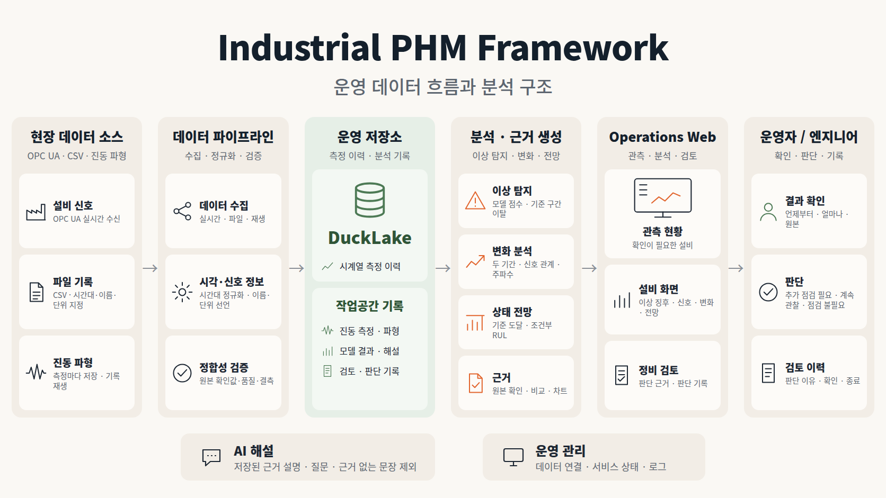

# Industrial PHM Framework

**산업 설비의 실제 계측 데이터를 연결·관측·분석하고 근거를 확인하는 오픈소스 PHM 애플리케이션입니다.**

CSV·OPC UA·베어링 진동 기록을 설비별로 저장하고, 신호 변화·이상 탐지·기간 비교·상태 전망을 같은 웹 화면에서 다룹니다. 분석 근거를 확인한 뒤 사람의 검토를 기록할 수 있습니다. 모델 성능 평가를 위한 별도 제품이 아니라 **실제 데이터 분석 도구**입니다.

## 주요 기능

- **데이터 연결:** CSV 등록·검증·이력 저장, OPC UA 수집·재연결, 설비·측정 지점·채널별 이력 탐색
- **신호 분석:** 시간 추세, 특징 분포, 두 기간 비교, 채널 간 관계, 진동 파형·주파수 분석
- **이상 징후:** 연결한 Isolation Forest·LSTM 오토인코더·PCA 잔차 모델의 점수 비교, 모델 없는 이력의 기준 구간 이탈 탐색
- **상태 전망:** 선택한 신호의 추세와 사용자가 지정한 관리·종료 기준까지 예상되는 시간
- **AI 해설 및 검토:** 저장된 수치 근거에 기반한 질문·설명, 선택적 사람의 검토 기록

이상 점수는 고장 확정이 아닙니다. 화면의 잔여수명(RUL)은 **사용자가 정한 신호 종료 기준에 도달할 때까지의 조건부 전망**이며, 실제 고장 발생 시점의 예측으로 해석하면 안 됩니다.

## 시작하기

**macOS:** Docker Desktop·Docker Compose·make가 필요합니다. **Linux:** uv·Python 3.14·Node.js 22.12+·npm·make가 필요합니다.

```bash
git clone https://github.com/so9093-K/industrial-phm-framework.git
cd industrial-phm-framework
make up
```

웹: http://127.0.0.1:2718/web/

시작 화면에서 **데이터 연결**로 이동하여 CSV를 등록하거나 OPC UA 소스를 연결합니다. 데이터를 준비한 뒤 관측·설비 분석·상태 전망으로 이동합니다.

```bash
make status
make logs
make down
```

macOS의 `make up`은 Linux 컨테이너를 사용하고, Linux의 기본 실행은 네이티브입니다. 데이터는 각각 Docker 볼륨 또는 `artifacts/operations` 작업공간에 저장합니다.

## 실제 공개 데이터로 분석

원본 데이터셋은 이 저장소에 재배포하지 않습니다. 각 제공자의 이용 조건에 따라 로컬에 준비하세요.

**XJTU-SY 베어링 진동 기록:** 학습에 사용하지 않은 베어링의 실측 파형을 작업공간에 재생하고 두 이상 탐지 모델의 점수와 원본 근거를 확인할 수 있습니다.

```bash
uv sync --locked --extra operations
uv run industrial-phm demo xjtu --until 100
```

실측 원본은 `data/interim/xjtu-sy/XJTU-SY_Bearing_Datasets`에 준비합니다. `--until` 없이 실행하면 해당 베어링의 전체 기록을 사용하며, `--source`·`--bearing`·`--workspace` 옵션으로 입력을 바꿀 수 있습니다. 실측 기록은 `industrial-phm demo xjtu`가 지정한 로컬 Operations 작업공간에 재생합니다. `--prepare-only`를 사용하면 모델 준비와 실측 기록 재생 후 Web을 시작하지 않고 종료합니다.

**AI-Hub 239:** 보일러·압출기·공기압축기의 전기적 측정 이력을 로컬에서 준비하고, 파일 이력 및 기록 기반 OPC UA 재생에 활용합니다. 보일러 기록 재생은 `uv run industrial-phm demo aihub-boiler`를 사용하며 원본 아카이브와 관련 선택 의존성이 필요합니다.

IMS 및 MIMII DUE 등 공개 데이터는 별도의 연구용 어댑터·결과와 함께 유지합니다. 합성 데이터를 이용한 별도 제품 시연과 캡처 배포물은 제공하지 않습니다.

## 기술 구성 및 제약

Python 3.14·DuckDB/DuckLake·SQLite·PyTorch·scikit-learn·Prophet·asyncua·Svelte/TypeScript 기반입니다. AI 해설에는 OpenAI 호환 모델 서버가 필요하며 나머지 분석은 AI 서버 없이 가능합니다.

현재는 **로컬 단일 사용자**를 대상으로 하며 원격 인증·TLS·다중 사용자 운영을 지원하지 않습니다. 현장 고장 진단·자동 정비 지시·장비 제어 기능으로 사용하지 마세요.



## 문서

- [데이터 준비 및 출처](data/README.md)
- [실제 데이터로 시작](docs/product/data-first-start.md)
- [Operations 실행 및 실기록 재생](apps/README.md)
- [지원 범위와 제한](docs/status.md)
- [아키텍처](docs/architecture/overview.md)
- [연구 자료 및 결과](docs/research/README.md)
- [기여 및 개발](CONTRIBUTING.md)

프로젝트 코드는 [Apache License 2.0](LICENSE)을 따릅니다. 외부 데이터셋·모델의 라이선스는 별도로 확인해야 합니다.
