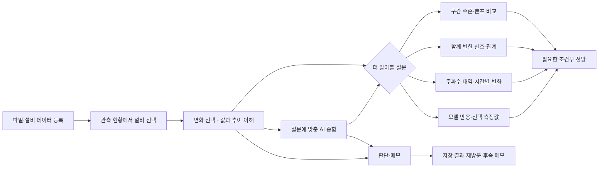

# 제품 UX 검토와 개편 작업안

2026-11-19 · main `5e565430`에서 검토 · 개편 작업과 검증 진행

## 목적과 검토 범위

사용자가 실제 설비 데이터에서 중요한 변화를 발견하고, 그 의미를 이해하고, 필요한 비교를 수행하도록 만든다. 한 화면에 모든 분석 결과와 설명을 제공하는 방식을 재검토한다.

첫 방문 → 데이터 등록 → 관측 현황 → 변화 조사 → 비교·관계·주파수·모델 해석 → 조건부 전망 → 기록·재방문을 검토했다. 모든 사용자가 이 단계를 순서대로 수행하도록 만들지는 않는다.

- 원격 main과 로컬 HEAD가 같은지 확인했다.
- 현재 코드, 제품 지침, `.other/img`의 실제 기록 화면 11개, 3차 과제 PDF를 읽었다. `.other`는 수정하지 않았다.
- 실행 중인 화면에서는 1440×900에서 관측 현황, 베어링 요약, 데이터 연결, 검토함을 읽기 전용으로 확인했다. 신규 등록·저장·AI 생성은 수행하지 않았다. 빈 작업공간의 첫 방문은 소스와 기존 검증 자료로 검토했다.
- 이 문서는 구조·경험에 관한 검토다. 신규 계산 오류의 재현 보고서나 전체 브라우저 회귀 테스트 결과는 아니다.

## 핵심 진단

복잡함은 정보량과 구성 방식에서 함께 발생한다. 문장을 줄이거나 설명을 접는 수정만으로는 해결하기 어렵다.

| 확인한 구조 | 사용자에게 생기는 부담 | 바꿀 대상 |
| --- | --- | --- |
| 분석 방법별 화면이 각각 결과·선택·해석을 소유한다 | 같은 현상을 여러 화면에서 조사하고 결과를 기억해 종합해야 한다 | 화면 경계와 선택 공유 방식 |
| 설비 요약이 변화·근거·판단 입력·AI·이전 검토를 함께 다룬다 | 이해하기 전에 여러 행동과 설명을 마주한다 | 요약의 기본 표시와 후속 행동 |
| 여러 분석에 넓은 본문과 280px 설정창을 공통 적용한다 | 작업에 맞지 않는 배치, 긴 설정창과 아래로 쌓이는 결과가 반복된다 | 공통 배치 지침과 개별 작업 구성 |
| 결과·해석·주의·검증에서 비슷한 설명을 반복한다 | 가장 중요한 결론과 제약을 구별하기 어렵다 | 내용의 소유 위치와 시각적 위계 |
| 관련 그래프의 탐색 상태가 분리되어 있다 | 같은 구간·측정·대역을 다시 찾아야 한다 | 그래프 간 연결 |

구체적으로 스펙트럼의 대역 확대는 이미 있지만, 별도 워터폴에는 선택 대역이 전달되지 않는다. 모델 점수 선택·원본 확인·특징 비교도 이미 있지만, 한 측정을 이해하는 정보가 긴 페이지에 분산되어 있다. 기능을 중복 추가할 필요가 없다.

## 3차 과제에서 적용할 표현 원칙

15~17쪽은 RMS 추이 → 전후 분포 → 피크·주파수 특성으로 질문을 발전시킨다. 각 그림의 목적과 짧은 관찰 결과가 연결되어 있다. 웹에서는 이 연결성을 사용자가 선택하고 비교할 수 있는 경험으로 옮긴다.

- 제목은 지금 해결하는 질문이나 관찰 결과를 설명한다.
- 핵심 비교와 해석을 해당 그래프 가까이에 둔다.
- 함께 읽어야 하는 정보와 별개의 조사 과제를 구별한다.
- 발표 자료의 고정된 순서와 과거 사례 수치를 그대로 제품 규칙으로 사용하지 않는다.

## 화면별 정리 방향

| 화면 | 기본 화면이 답할 질문 | 정리할 내용 |
| --- | --- | --- |
| 첫 방문 | 어떤 데이터로 시작할까? | 세 가지 시작 경로는 유지하고, 기능 설명은 등록의 필수 읽기 과제로 만들지 않는다 |
| CSV·공개 데이터 등록 | 무엇을 저장하고 어디서 분석할까? | 파일·시간·저장 열·단위·설비 확인을 묶고, 저장 처리와 연결 운영 정보는 분리한다 |
| 관측 현황 | 어느 설비의 무엇을 먼저 볼까? | 설비·대표 변화·추이·실제 측정 시점을 우선한다. 모델·검토·운영 항목의 기본 노출 필요성을 다시 판단한다 |
| 설비 요약 | 무엇이 언제 얼마나 달라졌나? | 대표 변화와 전후 추이를 중심으로 둔다. 판단 입력·AI·전체 근거를 동시에 기본 배치하지 않는다 |
| 신호 조사 | 선택한 구간에서 어떻게 움직였나? | 관련 신호의 시간축·선택 구간을 연결하고, 원본 값과 비교로 이어지는 동작을 가까이 둔다 |
| 기간 비교·신호 관계 | 값의 수준·퍼짐·관계가 어떻게 달라졌나? | A/B를 일관되게 표현하고, 의미 있는 차이와 차이가 작다는 결과를 모두 읽을 수 있게 한다 |
| 모델 결과 | 어느 측정에서 무엇이 특이했나? | 점수와 선택 측정의 변화 정보를 연결한다. 학습하지 않은 운전 조건 등 해석에 중요한 제약을 해당 결과에 붙인다 |
| 주파수 분석 | 어떤 대역이 언제부터 달라졌나? | 스펙트럼·시간별 주파수·선택 측정을 연결하고, 피크·대역 목록의 중복을 줄인다 |
| 3상 분석 | 어느 시점의 3상 패턴이 달라졌나? | 추이·확인할 시점·선택 시점의 값을 함께 조사하도록 구성한다 |
| 전망 | 이 전망으로 무엇을 판단할 수 있나? | 전망의 유용성에 맞춰 결과 강조를 바꾼다. 단순 예측보다 못한 결과에 같은 무게의 도달 시점을 강조하지 않는다 |
| 기록·재방문 | 전에 무엇을 보고 어떻게 판단했나? | 저장 결과와 후속 메모 흐름은 활용하고, 기술적 실행 기록을 사용자 결론보다 앞세우지 않는다 |

## 실제 작업 묶음과 순서

### 1. 화면 역할과 정보 구조 확정

전력 변화 조사, 베어링 변화 조사, 저장 결과 재방문의 세 흐름을 실제 데이터로 정리한다. 각 단계의 질문·필요 정보·사용자 선택을 표시한다. 기존 기능을 유지·통합·이동할 위치를 결정하고, 상단 탭과 분석 진입 방식도 함께 검토한다.

산출물: 흐름도와 화면별 기본 정보 목록. 각 화면에 여러 목적을 동시에 넣지 않았는지 검토한다.

### 2. PC 화면 시안과 표현 체계

1440×900과 1280×900을 기준으로 관측·요약·선택 측정 조사·A/B 비교·주파수 조사의 시안을 함께 만든다. 화면별 작업에 맞춰 배치를 정한다. 공통 설정창을 전제로 하지 않는다.

제목·대표 수치·본문·보조 정보, A/B 색, 실제값·모델값·전망, 단위·소수 자릿수·범례를 정한다. 내부 식별자와 관리 메타데이터는 필요한 상세에서 확인하게 한다. 실제 측정 시점과 해석에 영향을 주는 제약은 읽을 수 있게 유지한다.

산출물: 실제 데이터가 들어간 주요 화면 시안과 작은 공통 표현 규칙. 글자를 줄여 모든 내용을 넣거나 접기 영역을 늘리는 방식으로 해결하지 않는다.

### 3. 연결된 그래프와 조작 설계

기존 확대·측정 선택·키보드 조작을 재사용한다. 점수와 신호의 같은 시점, A/B 비교 구간, 스펙트럼과 워터폴의 같은 대역을 함께 탐색하도록 설계한다. 설정은 사용 시점 가까이에 둔다.

산출물: 구간·측정·대역을 선택하고 비교하는 동작이 가능한 프로토타입. 관련 정보를 찾으려고 페이지를 반복해서 왕복하지 않아야 한다.

### 4. 인사이트와 LLM 활용 설계

관찰된 사실, 설명할 수 있는 범위, 유용한 다음 비교를 연결한다. 고장 원인을 확인하지 못한 상태에서 단정하지 않는다. 차이가 작거나 예측이 도움이 되지 않는 경우도 명확한 결과로 표현한다.

LLM은 사용자의 질문에 맞춘 결과 종합, 모델 결과의 차이와 분석 제약 설명, 다음 비교 제안, 짧은 조사 요약에 활용한다. 어떤 계산 결과가 필요하고 현재 제공 가능한지 먼저 확인한다. 현재 베어링 AI 해설이 이미 있는 만큼 숫자를 반복하는 새 패널부터 만들지 않는다. 필요한 기능 연결은 실행 범위와 화면 확인 방식을 정한 뒤 구현한다.

산출물: 전력·진동 각각의 실제 질문과 기대 답변 예시, 필요한 기존 계산 결과 목록. 기존 화면만 읽었을 때보다 무엇을 더 이해할 수 있는지 평가한다.

### 5. 구현 구조 정리와 흐름 단위 구현

화면 컴포넌트에서 그래프·조작·선택 결과를 필요한 수준으로 분리한다. 기존 주소의 출처·위치·신호·기간을 유지하고, 선택 시점·대역을 관련 구성 요소에 전달한다. 계산과 API는 재사용하며, 필요한 변경만 추가한다.

전력·베어링 한 흐름씩 끝까지 구현해 공통 구조의 적합성을 확인한 뒤 다른 화면에 적용한다. 기존 `desktop-analysis-workspace.md`의 공통 배치와 요약 역할도 확정 설계에 맞춰 개정한다.

산출물: 실제 데이터로 작동하는 완결된 조사 흐름. 작은 문구 수정들을 개편 완료로 취급하지 않는다.

### 6. 실제 사용 확인과 마무리

처음 진입 → 변화 발견 → 구간 조사 → 필요한 비교 → 이해한 내용 기록·재방문을 직접 수행한다. 주요 화면의 기본 상태와 선택 후 상태를 함께 확인한다.

완료 기준은 사용자가 무엇이 달라졌는지 설명하고, 필요한 비교를 수행하고, 해석의 중요한 한계를 알고, 다시 같은 조사로 돌아올 수 있는지다. PC에서 핵심 결과와 그래프를 읽고 조작할 수 있는지, 중복 설명·과도한 스크롤·선택 유실·불필요한 재계산이 줄었는지도 확인한다. 변경에 맞는 기존 테스트와 실제 브라우저 확인을 수행한다.

## 현재 준비 상태

검토 후 아래 흐름으로 기존 분석의 배치와 상호작용을 개편했다. 실제 기록을 읽는 실행 화면을 시안과 프로토타입으로 사용했다.

- 첫 시작·등록·관측 표는 기존 경로를 유지한다. 설비 요약의 다른 변화는 선택 목록으로 옮겼으며, 기본 화면에는 선택한 변화의 설명·값·그래프·다음 질문을 둔다.
- 주요 비교·주파수·3상 분석의 설정을 별도 작업으로 분리했다. 신호와 전망의 주요 선택은 그래프 위에서 바로 조작한다.
- 모델 점수와 선택 측정의 주요 값, 진동 A/B 추이와 분포, 스펙트럼과 시간별 주파수를 각각 함께 조사하도록 구성했다.
- 모델 해석에 중요한 운전 조건 제약은 기본 결과에 남겼다. 예측이 단순 예측보다 못하면 기준 도달 시점을 주요 결과로 강조하지 않는다.
- 기존 진동 AI의 다중 결과 해석에 실제 후속 분석 동작을 연결했다. 판단 창의 입력을 보존하고, 닫힌 AI 영역의 반복 조회를 중지한다.
- 계산 API와 저장 기록을 재사용했다. 실제 데이터·`.other`·운영 스택은 변경하지 않고 별도 읽기 전용 미리보기와 격리 테스트 작업공간에서 확인한다.
