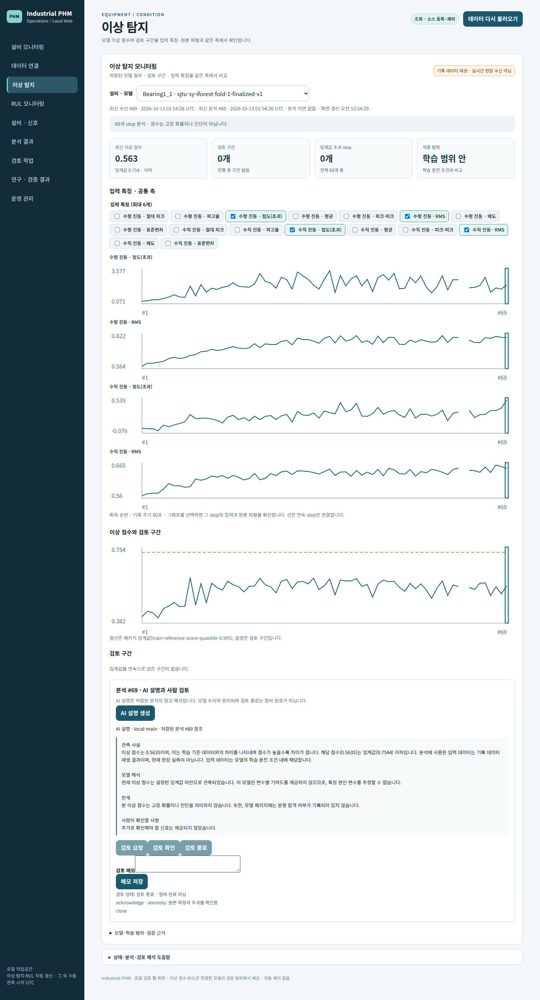
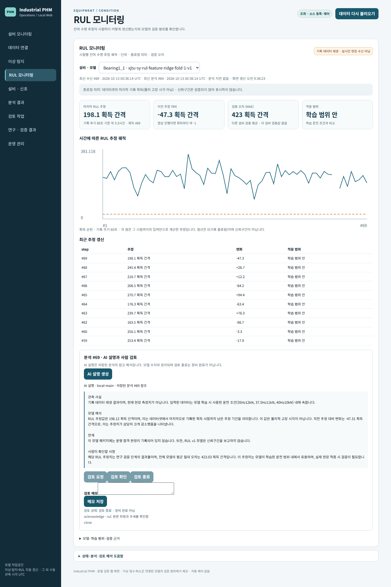
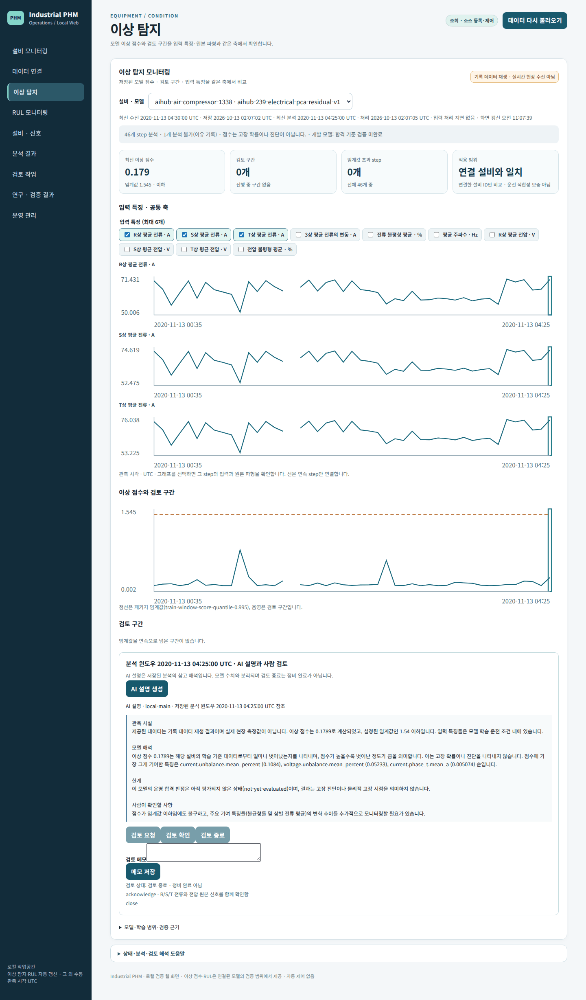
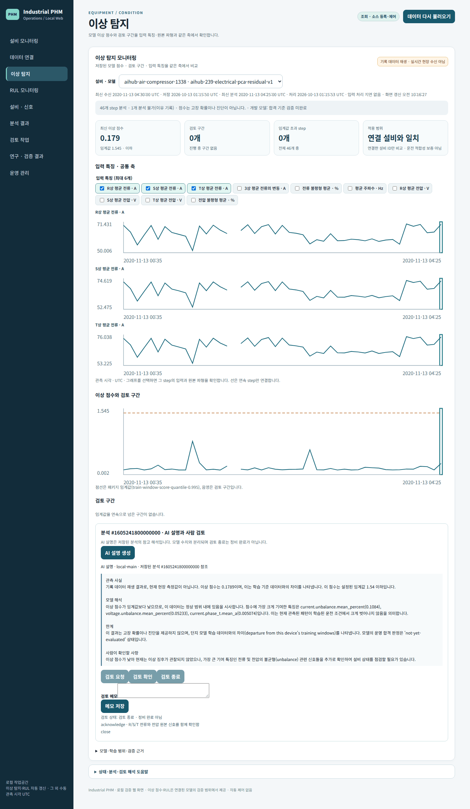

# PHM 제품 인수 결과 (2026-10-13)

두 검증 사례를 감독형 Operations 노드(`operations start`) 하나의 흐름으로 실행한 결과입니다.
기록 데이터 재생이며 현장 설비 수신이 아닙니다. 판정 기준은
[운영 추론 수용 프로토콜](../../operational-inference-acceptance-protocol.md)의 지연 한도를 따릅니다.

- 제품 코드: main `cb00dbf`와 동일. 인수 도구만 추가(`tools/phm/acceptance_*.py`)
- AI 설명: 실제 `local-main`(`http://127.0.0.1:9400/v1`)
- 브라우저: Chromium 1440px, ko-KR

| 사례 | 흐름 | 판정 | 근거 |
| --- | --- | --- | --- |
| XJTU-SY Bearing1_1 (진동 이상 + RUL) | 패키지 생성 → 바인딩 4개 → 1초 간격 획득 공급 → 감독 중단 중 공급 → 재시작 → 공백 → 중복 → 비호환 입력·변조 패키지 → 화면 → AI 설명 → 검토 → 재시작 | **PASS** (24/24) | [xjtu-evidence.json](xjtu-evidence.json) |
| AI-Hub 239 공기압축기 1338 (전기 이상) | 재생 원천 등록 → 보류 기간 PCA 패키지 → OPC UA 재생(원래 기록 시각, 20배속) → 감독 중단·재시작 → 화면 → AI 설명 → 검토 → 재시작 | **PASS** (13/13) | [aihub-evidence.json](aihub-evidence.json) |

## 지연 (프로토콜 한도 대비)

| 구간 | 한도 | XJTU-SY | AI-Hub |
| --- | --- | --- | --- |
| 획득 공급 → 결과 커밋 p95 | ≤ 2초 | IForest 0.769초 · Ridge 0.661초 · LSTM-AE 0.619초 · LSTM-RUL 0.631초 | — |
| 윈도우 확정 → 결과 커밋 p95 | ≤ 10초 | — | 1.784초 (47개) |
| 결과 커밋 → 화면 반영 p95 | ≤ 폴링 3초 + 2초 | 2.849초 (45개, 미반영 0) | 2.768초 (46개, 미반영 0) |

화면 반영은 브라우저에서 표시 변화를 시각과 함께 기록해, 각 커밋부터 그 결과 또는 더 새로운
결과가 처음 보인 시각까지를 잽니다. 화면이 3초마다 갱신되므로 결과가 더 빨리 쌓이면 일부는
다음 결과로 대체된 뒤에 보입니다.

## 장애 주입

| 상황 | 결과 |
| --- | --- |
| 감독 중단 중 공급(XJTU 15개) | 재시작 후 15개 모두 처리, 바인딩별 결과 정확히 1개 |
| 공백(XJTU 61번 누락) | LSTM 8개 버퍼를 다시 모음(준비 구간 1–7, 62–68). 그래프는 선을 끊어 표시 |
| 중복 공급(XJTU 1–10 재공급) | `delivered=0 already_present=10`, 결과 변화 없음 |
| 비호환 입력(다른 채널) | 화면에 "입력을 분석할 수 없습니다: channels differ…" |
| 변조된 패키지 | 화면에 "모델을 실행할 수 없습니다: model package payload digest mismatch", 결과 0개 |
| 수집 중단(AI-Hub 감독 중단 약 18초) | 중단 중 화면은 "PHM 분석 결과를 읽지 못했습니다"(마지막 결과를 현재처럼 보이지 않음). 공백은 기록 시각 01:52:56–01:59:01뿐이며 겹친 두 윈도우만 부분(107·70/175값), 빠진 윈도우 0 |
| 재시작 | 기존 결과·AI 설명·검토 기록 그대로. 결과 변경 0 |
| RUL 근거 없는 설비(AI-Hub) | RUL 화면이 "근거가 없는 설비에는 표시하지 않습니다"로 안내, 추정 없음 |

## 화면

| XJTU 이상 탐지 · 설명 · 검토 | XJTU RUL · 설명 · 검토 |
| --- | --- |
|  |  |

| AI-Hub 이상 탐지 · 설명 · 검토 | AI-Hub 재시작 후 |
| --- | --- |
|  |  |

재시작 후 XJTU 화면: [이상 탐지](xjtu-anomaly-after-restart.png) · [RUL](xjtu-rul-after-restart.png)

## 인수에서 찾은 결함과 수정

| 결함 | 수정 | 화면 |
| --- | --- | --- |
| 비호환 입력 거부가 들어온 채널만 보여주고 패키지 입력 규격·재학습 필요를 알리지 않음 | #545 | [수정 후](fix-incompatible-input-guidance.png) |
| 설명 패널이 윈도우를 내부 정렬 키(`#1605241800000000`)로 표시 | #546 | [수정 전](fix-explanation-before.png) · [수정 후](fix-explanation-after.png) |
| local-main이 임계값 이하 점수를 "정상 범위"라고 판정(숫자 대조로는 잡히지 않음) | #546: 프롬프트 판정 금지 + 판정 표현 경고 | [수정 전](fix-explanation-before.png) · [수정 후](fix-explanation-after.png) |

## 한계와 관찰

- **수집 처리량**: 수집기는 값마다 스풀 커밋과 원격 측정 기록을 하며, 이번 환경에서 약 18값/초를
  처리했습니다. AI-Hub 실시간 입력(35값/분)에는 약 30배 여유가 있지만, 60배속 재생(35값/초)에서는
  클라이언트 대기열이 쌓였습니다. 정상 종료는 아직 꺼내지 않은 알림을 비우지 않으므로
  ([ADR-0010](../../../adr/0010-application-owned-opcua-session-recovery.md) 손실 경계) 60배속에서는
  중단 손실이 중단 시간보다 컸습니다. 그래서 인수는 20배속으로 실행했습니다.
- **값이 바뀌지 않으면 윈도우가 닫히지 않음**: OPC UA는 값 변경 시에만 알리므로 설비가 멈춰 값이
  고정되면 마지막 윈도우는 다음 관측이 올 때까지 열려 있습니다(재구독 시 현재값으로 닫힘).
- 결과의 정확도(이상 탐지 탐지율·RUL 오차)는 이 인수의 판정 대상이 아닙니다. 성능 판정은
  [AI-Hub 평가 v2](../aihub-239-electrical-anomaly-evaluation-v2.json)(FAIL)와 프로토콜 §2.2·§5를 따릅니다.

## 실행

```bash
uv run --locked --all-extras --all-groups --with playwright python -m tools.phm.acceptance_xjtu \
  --source data/interim/xjtu-sy/XJTU-SY_Bearing_Datasets --lstm-models artifacts/phm-lstm/models \
  --output artifacts/acceptance/xjtu
uv run --locked --all-extras --all-groups --with playwright python -m tools.phm.acceptance_aihub \
  --archive data/raw/aihub/239/archives/training/raw/3.공기압축기.zip --output artifacts/acceptance/aihub
```

## 이전 단계 화면

같은 화면 계약의 이전 단계 기록입니다(각 단계 PR 시점 코드).

- M3 AI-Hub 전기 이상 탐지(PCA 잔차 기여, 공통 시간축 원본 신호): [earlier-m3-electrical-anomaly.png](earlier-m3-electrical-anomaly.png)
- M4 LSTM 이상 탐지·RUL: [earlier-m4-lstm-anomaly.png](earlier-m4-lstm-anomaly.png) · [earlier-m4-lstm-rul.png](earlier-m4-lstm-rul.png)
